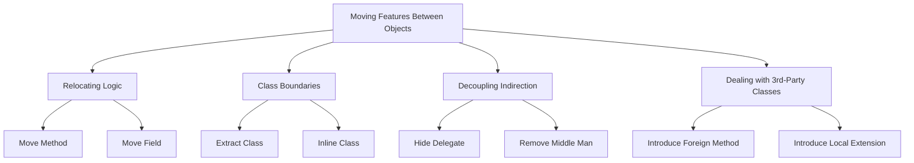

# Moving Features Between Objects 📦

## Source Reference
* **Book:** *Dive Into Refactoring* (Alexander Shvets), Chapter: *Refactoring Techniques / Moving Features between Objects*
* **Target Language:** Modern Python 3 (Python 3.10+) with `pytest`.

---

## Overview

Even if you have broken down methods into well-proportioned chunks, you can still have code where **responsibilities are distributed across the wrong classes**. If a class has too many responsibilities, or if two classes are constantly talking behind each other's backs, you need to relocate functionality safely.

The techniques in this group move functionality between classes, create new classes when an existing one is bloated, inline redundant classes, and enforce strict boundaries.

---

## The 8 Techniques in this Group

| Technique | Problem Solved | Core Transformation |
| :--- | :--- | :--- |
| [**Move Method**](move-method.md) | Method used more by another class than its own | Move method to the class that uses it most |
| [**Move Field**](move-field.md) | Field used more by another class than its own | Move field to the target class and update accessors |
| [**Extract Class**](extract-class.md) | One class does the work of two | Create new class and move relevant fields & methods |
| [**Inline Class**](inline-class.md) | A class isn't doing enough to justify its existence | Move all features into another class and delete it |
| [**Hide Delegate**](hide-delegate.md) | Client calls `a.get_b().get_c()` directly | Create method on A to delegate call directly |
| [**Remove Middle Man**](remove-middle-man.md) | Class has too many pass-through methods | Have client call delegate object directly |
| [**Introduce Foreign Method**](introduce-foreign-method.md) | Library class lacks a method and you can't edit it | Add helper function taking library object as 1st argument |
| [**Introduce Local Extension**](introduce-local-extension.md) | Library class lacks multiple methods | Create a subclass or wrapper class around it |
