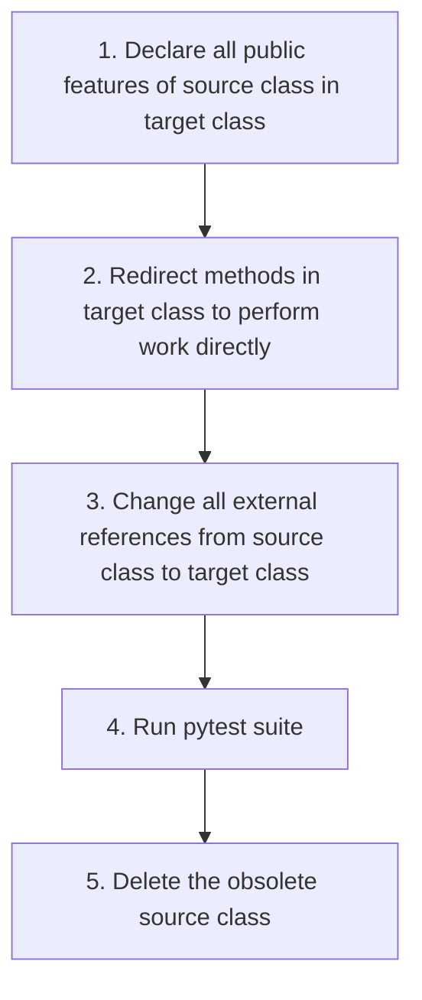

# Inline Class 🗜️

## Source Reference
* **Book:** *Dive Into Refactoring* (Alexander Shvets), Chapter: *Refactoring Techniques / Moving Features between Objects / Inline Class*
* **Fixes Code Smells:** [Lazy Class](../../code-smells/dispensables/lazy-class.md), [Speculative Generality](../../code-smells/dispensables/speculative-generality.md)
* **Target Language:** Modern Python 3 (Python 3.10+) with `pytest`.

---

## 1. Intent and Motivation

A class is **no longer doing enough to justify its existence**. Most of its methods have been moved to other classes, or its original purpose was superseded. **Move all its remaining features into another class and delete the useless class entirely.**

Inline Class is the inverse of [Extract Class](extract-class.md). It is frequently used when two classes that were once distinct have evolved to the point where separating them creates unnecessary indirection and boilerplate.

---

## 2. Step-by-Step Mechanics



1. **Declare Features in Target:** Add methods and fields in the target class corresponding to the source class's public interface.
2. **Move Operations:** Move internal logic from the source class directly into the target class.
3. **Redirect Callers:** Update external callers to communicate directly with the target class.
4. **Test:** Run tests to verify identical behavior.
5. **Delete:** Remove the source class from the codebase.

---

## 3. Python Before & After Demonstration

### A. Smelly / Legacy Code (Anemic TrackingInformation Class)
```python
# shipping_smelly.py
class TrackingInformation:
  """Smelly: Freeloader class with only 1 attribute that adds zero real value."""

  def __init__(self, tracking_number: str) -> None:
    self.tracking_number = tracking_number

  def get_display_text(self) -> str:
    return f"TRACKING: {self.tracking_number}"


class Shipment:

  def __init__(self, tracking_number: str) -> None:
    self.tracking_info = TrackingInformation(tracking_number)

  def get_tracking_summary(self) -> str:
    return self.tracking_info.get_display_text()
```

### B. Pytest Baseline Contract
```python
# test_shipping.py
from shipping_smelly import Shipment


def test_shipment_tracking():
  shipment = Shipment("TRK-999")
  assert shipment.get_tracking_summary() == "TRACKING: TRK-999"
```

### C. Refactored Clean Code (Inlined Class)
```python
# shipping_clean.py
class Shipment:
  """Clean class: Absorbed tracking information directly, eliminating the freeloader."""

  def __init__(self, tracking_number: str) -> None:
    self.tracking_number = tracking_number

  def get_tracking_summary(self) -> str:
    return f"TRACKING: {self.tracking_number}"
```

---

## 4. Complexity, Trade-offs & Anti-patterns

* **Don't Re-Create God Classes:** Inlining is appropriate for anemic, 1-attribute wrappers. Do not inline a class if doing so turns the target into a bloated [Large Class](../../code-smells/bloaters/large-class.md).

---

## 5. Related Techniques & Design Patterns

* **Opposite:** [Extract Class](extract-class.md).
* **Companion:** [Collapse Hierarchy](../generalization/collapse-hierarchy.md).
