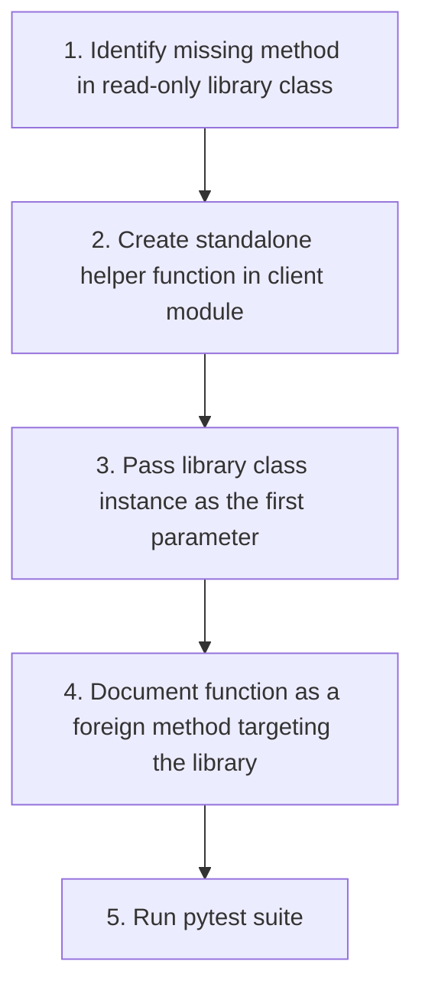

# Introduce Foreign Method 🌐

## Source Reference
* **Book:** *Dive Into Refactoring* (Alexander Shvets), Chapter: *Refactoring Techniques / Moving Features between Objects / Introduce Foreign Method*
* **Fixes Code Smells:** [Incomplete Library Class](../../code-smells/couplers/incomplete-library.md)
* **Target Language:** Modern Python 3 (Python 3.10+) with `pytest`.

---

## 1. Intent and Motivation

A utility or library class that you cannot modify (e.g., in Python standard library `datetime` or a third-party SDK in `site-packages`) **lacks a method you desperately need**. **Add the method to your client class or module, and pass an instance of the library class as its first argument.**

Use Introduce Foreign Method when you only need one or two missing methods. If you need many methods or want to manage persistent state, use [Introduce Local Extension](introduce-local-extension.md) instead.

---

## 2. Step-by-Step Mechanics



1. **Create Method in Client:** Define a function in the client class or utility module.
2. **First Parameter:** Make the library object the first parameter (e.g., `def next_business_day(date_obj: datetime.date) -> datetime.date:`).
3. **Comment/Tag:** Add a docstring noting that this is a foreign method serving the external class.
4. **Test:** Verify with `pytest`.

---

## 3. Python Before & After Demonstration

### A. Smelly / Legacy Code (Inlined Ad-Hoc Library Workaround)
```python
# report_smelly.py
import datetime


class PayrollReport:

  def generate_submission_deadline(
      self, cutoff_date: datetime.date
  ) -> datetime.date:
    # Smelly: Ad-hoc date manipulation inlined directly inside domain logic
    deadline = cutoff_date + datetime.timedelta(days=1)
    if deadline.weekday() == 5:
      deadline += datetime.timedelta(days=2)
    elif deadline.weekday() == 6:
      deadline += datetime.timedelta(days=1)
    return deadline
```

### B. Pytest Baseline Contract
```python
# test_report.py
import datetime
from report_smelly import PayrollReport


def test_payroll_deadline():
  friday = datetime.date(2026, 11, 6)
  monday = datetime.date(2026, 11, 9)
  assert (
      PayrollReport().generate_submission_deadline(friday) == monday
  )
```

### C. Refactored Clean Code (Introduce Foreign Method)
```python
# report_clean.py
import datetime


def next_business_day(target_date: datetime.date) -> datetime.date:
  """Foreign Method on datetime.date: Calculates next weekday."""
  candidate = target_date + datetime.timedelta(days=1)
  while candidate.weekday() >= 5:  # 5 = Saturday, 6 = Sunday
    candidate += datetime.timedelta(days=1)
  return candidate


class PayrollReport:
  """Clean class: delegates business date calculation to reusable foreign method."""

  def generate_submission_deadline(
      self, cutoff_date: datetime.date
  ) -> datetime.date:
    return next_business_day(cutoff_date)
```

---

## 4. Complexity, Trade-offs & Anti-patterns

* **Avoid Monkeypatching:** In Python, it is tempting to monkeypatch `datetime.date.next_business_day = ...`. This is dangerous because it pollutes global interpreter state and risks breaking third-party dependencies. Pure foreign functions are much safer.

---

## 5. Related Techniques & Design Patterns

* **Next Step (when multiple methods are needed):** [Introduce Local Extension](introduce-local-extension.md).
* **Fixes:** [Incomplete Library Class](../../code-smells/couplers/incomplete-library.md).
