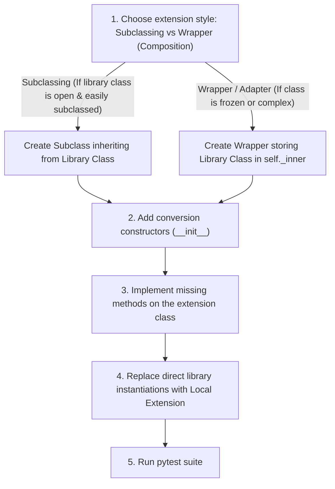

# Introduce Local Extension 🔌

## Source Reference
* **Book:** *Dive Into Refactoring* (Alexander Shvets), Chapter: *Refactoring Techniques / Moving Features between Objects / Introduce Local Extension*
* **Design Pattern Bridge:** [Adapter Pattern](../../../design-patterns/structural/adapter.md), [Decorator Pattern](../../../design-patterns/structural/decorator.md)
* **Fixes Code Smells:** [Incomplete Library Class](../../code-smells/couplers/incomplete-library.md)
* **Target Language:** Modern Python 3 (Python 3.10+) with `pytest`.

---

## 1. Intent and Motivation

A third-party or standard library class **lacks several methods that you need**, and you cannot edit the library source. **Create a new class that contains these methods and make it either a subclass or a wrapper (adapter) around the library class.**

Introduce Local Extension is the scaled-up solution when [Introduce Foreign Method](introduce-foreign-method.md) is not enough. When you need 3 or more methods or require custom internal state alongside the library data, a dedicated local extension class is required.

---

## 2. Step-by-Step Mechanics



1. **Choose Strategy:**
   - **Subclassing:** Direct inheritance. Easier, but can cause problems if the library class returns instances of itself from its methods.
   - **Wrapper (Composition / Adapter):** Store the library object inside `self._inner` and delegate calls. Far more robust and decoupled.
2. **Implement Missing Methods:** Add all the custom domain features and helpers to the local extension.
3. **Migrate Call Sites:** Use the local extension across your project.
4. **Test:** Verify with `pytest`.

---

## 3. Python Before & After Demonstration

### A. Smelly / Legacy Code (Scattered Foreign Methods for Third-Party Client)
```python
# payment_smelly.py
# External third-party SDK that we cannot modify:
class StripeRawClient:

  def create_charge(self, amount_cents: int, currency: str) -> dict:
    return {"id": "ch_123", "amount": amount_cents, "currency": currency}


# Client code scattered with repetitive conversion math:
class CheckoutService:

  def __init__(self, client: StripeRawClient) -> None:
    self.client = client

  def checkout_usd(self, dollar_amount: float) -> dict:
    # Foreign conversion logic repeated everywhere:
    cents = int(dollar_amount * 100)
    return self.client.create_charge(cents, "usd")
```

### B. Pytest Baseline Contract
```python
# test_payment.py
from payment_smelly import CheckoutService, StripeRawClient


def test_checkout_conversion():
  raw_client = StripeRawClient()
  checkout = CheckoutService(raw_client)
  res = checkout.checkout_usd(29.99)

  assert res["amount"] == 2999
  assert res["currency"] == "usd"
```

### C. Refactored Clean Code (Introduce Local Extension - Wrapper Adapter)
```python
# payment_clean.py
class StripeRawClient:
  """Simulated 3rd-party library class (read-only)."""

  def create_charge(self, amount_cents: int, currency: str) -> dict:
    return {"id": "ch_123", "amount": amount_cents, "currency": currency}


class ExtendedStripeClient:
  """Local Extension (Wrapper Adapter) adding rich domain methods to StripeRawClient."""

  def __init__(self, raw_client: StripeRawClient) -> None:
    self._raw_client = raw_client

  def charge_dollars(
      self, dollar_amount: float, currency: str = "usd"
  ) -> dict:
    """Extension method: encapsulates dollar-to-cents conversion seamlessly."""
    cents = int(round(dollar_amount * 100))
    return self._raw_client.create_charge(cents, currency.lower())

  # Can delegate raw methods via __getattr__ or explicit delegation if needed


class CheckoutService:
  """Clean service: interacts with domain-friendly ExtendedStripeClient."""

  def __init__(self, client: ExtendedStripeClient) -> None:
    self.client = client

  def checkout_usd(self, dollar_amount: float) -> dict:
    return self.client.charge_dollars(dollar_amount)
```

---

## 4. Complexity, Trade-offs & Anti-patterns

* **Subclassing vs Wrapper:** In Python, standard library types implemented in C (like `tuple`, `str`, `int`, `datetime.date`) often have rigid construction rules (`__new__` vs `__init__`). A **Wrapper Adapter** using composition is almost always safer and cleaner than subclassing C-extensions.

---

## 5. Related Techniques & Design Patterns

* **Simpler Alternative (1 method only):** [Introduce Foreign Method](introduce-foreign-method.md).
* **Companion Pattern:** [Adapter Pattern](../../../design-patterns/structural/adapter.md), [Decorator Pattern](../../../design-patterns/structural/decorator.md).
