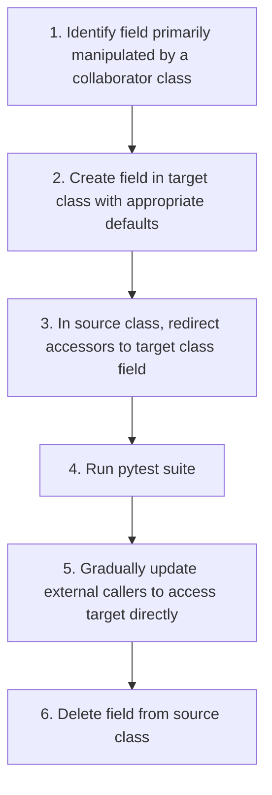

# Move Field 📦

## Source Reference
* **Book:** *Dive Into Refactoring* (Alexander Shvets), Chapter: *Refactoring Techniques / Moving Features between Objects / Move Field*
* **Fixes Code Smells:** [Shotgun Surgery](../../code-smells/change-preventers/shotgun-surgery.md), [Parallel Inheritance Hierarchies](../../code-smells/change-preventers/parallel-inheritance.md)
* **Target Language:** Modern Python 3 (Python 3.10+) with `pytest`.

---

## 1. Intent and Motivation

A field (instance attribute) is **used more in another class than in its own class**. **Create a field in the target class and redirect all users of the old field to the new one.**

Move Field frequently occurs when an architectural boundary shifts or when an [Extract Class](extract-class.md) refactoring is taking place. If every method operating on an attribute lives in a collaborator class, the attribute itself belongs in that collaborator.

---

## 2. Step-by-Step Mechanics



1. **Encapsulate Field First:** If the field is accessed publicly, apply [Encapsulate Field](../organizing-data/encapsulate-field.md) so you can redirect access via properties.
2. **Create in Target:** Define the field and initializers in the target class.
3. **Redirect Accessors:** Update the source class's properties/getters to fetch and modify the target class's field.
4. **Test:** Run tests to ensure no regression.
5. **Direct Access:** Update callers to use the target class directly where appropriate, then clean up obsolete source accessors.

---

## 3. Python Before & After Demonstration

### A. Smelly / Legacy Code (Interest Rate Defined in Account Instead of AccountType)
```python
# account_field_smelly.py
class AccountType:

  def __init__(self, name: str) -> None:
    self.name = name


class Account:

  def __init__(self, account_type: AccountType, interest_rate: float) -> None:
    self.account_type = account_type
    # Smelly: Interest rate depends on AccountType, but is stored on individual Account!
    self.interest_rate = interest_rate

  def calculate_interest(self, amount: float) -> float:
    return amount * self.interest_rate
```

### B. Pytest Baseline Contract
```python
# test_account_field.py
from account_field_smelly import Account, AccountType


def test_interest_calculation():
  acc_type = AccountType("SAVINGS")
  acc = Account(acc_type, interest_rate=0.05)
  assert acc.calculate_interest(1000.0) == 50.0
```

### C. Refactored Clean Code (Field Moved to AccountType)
```python
# account_field_clean.py
class AccountType:
  """Clean class: interest rate properly belongs to the account classification."""

  def __init__(self, name: str, interest_rate: float) -> None:
    self.name = name
    self._interest_rate = interest_rate

  @property
  def interest_rate(self) -> float:
    return self._interest_rate


class Account:

  def __init__(self, account_type: AccountType) -> None:
    self.account_type = account_type

  @property
  def interest_rate(self) -> float:
    # Forwarding property preserves backwards compatibility
    return self.account_type.interest_rate

  def calculate_interest(self, amount: float) -> float:
    return amount * self.interest_rate
```

---

## 4. Complexity, Trade-offs & Anti-patterns

* **Backward Compatibility:** Keep property getters/setters on the source class while migrating external consumers so you don't break existing call sites across large codebases in a single commit.

---

## 5. Related Techniques & Design Patterns

* **Companion:** [Move Method](move-method.md), [Extract Class](extract-class.md).
* **Next Steps:** [Encapsulate Field](../organizing-data/encapsulate-field.md).
