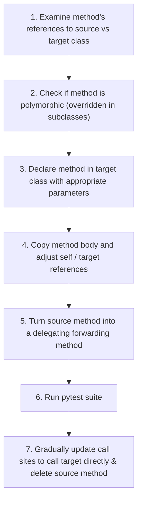

# Move Method 🚚

## Source Reference
* **Book:** *Dive Into Refactoring* (Alexander Shvets), Chapter: *Refactoring Techniques / Moving Features between Objects / Move Method*
* **Fixes Code Smells:** [Feature Envy](../../code-smells/couplers/feature-envy.md), [Shotgun Surgery](../../code-smells/change-preventers/shotgun-surgery.md), [Inappropriate Intimacy](../../code-smells/couplers/inappropriate-intimacy.md)
* **Target Language:** Modern Python 3 (Python 3.10+) with `pytest`.

---

## 1. Intent and Motivation

A method is **used more in another class than in its own class**. **Create a new method in the class that uses the method the most, then move code from the old method to there. Turn the old method into a simple delegation or delete it completely.**

Move Method is the bread-and-butter refactoring for achieving high cohesion and eliminating [Feature Envy](../../code-smells/couplers/feature-envy.md). Logic should live where the data lives (Information Expert).

---

## 2. Step-by-Step Mechanics



1. **Analyze Dependencies:** Verify that the method accesses more features on the target class than on the source class.
2. **Polymorphism Check:** Ensure the method is not part of an inheritance hierarchy that would break by moving it.
3. **Declare in Target:** Create the method in the target class.
4. **Adjust Code:** Adapt references: features from the target class now use `self`, while features from the source class are passed as arguments (or via a source object reference).
5. **Delegate & Test:** Replace the source method body with a call to the new target method. Run `pytest`.
6. **Eliminate Source:** Update callers to invoke the new method directly, then remove the delegating method.

---

## 3. Python Before & After Demonstration

### A. Smelly / Legacy Code (Bank Account Envious of Overdraft Calculation)
```python
# account_smelly.py
class AccountType:

  def __init__(self, is_premium: bool) -> None:
    self.is_premium = is_premium


class Account:

  def __init__(self, account_type: AccountType, days_overdrawn: int) -> None:
    self.account_type = account_type
    self.days_overdrawn = days_overdrawn

  # Smelly: This method calculates overdraft purely based on AccountType rules!
  def calculate_overdraft_charge(self) -> float:
    if self.account_type.is_premium:
      result = 10.0
      if self.days_overdrawn > 7:
        result += (self.days_overdrawn - 7) * 0.85
      return result
    return self.days_overdrawn * 1.75
```

### B. Pytest Baseline Contract
```python
# test_account.py
from account_smelly import Account, AccountType


def test_overdraft_charges():
  premium = AccountType(is_premium=True)
  standard = AccountType(is_premium=False)

  acc_prem = Account(premium, days_overdrawn=10)
  acc_std = Account(standard, days_overdrawn=10)

  assert acc_prem.calculate_overdraft_charge() == 12.55  # 10 + 3*0.85
  assert acc_std.calculate_overdraft_charge() == 17.50  # 10 * 1.75
```

### C. Refactored Clean Code (Moved to Information Expert)
```python
# account_clean.py
class AccountType:
  """Clean class: owns overdraft calculation rules corresponding to its account tier."""

  def __init__(self, is_premium: bool) -> None:
    self.is_premium = is_premium

  def calculate_overdraft_charge(self, days_overdrawn: int) -> float:
    if self.is_premium:
      result = 10.0
      if days_overdrawn > 7:
        result += (days_overdrawn - 7) * 0.85
      return result
    return days_overdrawn * 1.75


class Account:

  def __init__(self, account_type: AccountType, days_overdrawn: int) -> None:
    self.account_type = account_type
    self.days_overdrawn = days_overdrawn

  def calculate_overdraft_charge(self) -> float:
    # Clean delegation: Information Expert handles calculation
    return self.account_type.calculate_overdraft_charge(self.days_overdrawn)
```

---

## 4. Complexity, Trade-offs & Anti-patterns

* **Avoid Ping-Pong Coupling:** If moving a method to Class B causes it to now need 10 fields from Class A, you may have picked the wrong direction or the method needs to be split first with [Extract Method](../composing-methods/extract-method.md).

---

## 5. Related Techniques & Design Patterns

* **Companion:** [Move Field](move-field.md), [Extract Class](extract-class.md).
* **Fixes:** [Feature Envy](../../code-smells/couplers/feature-envy.md).
