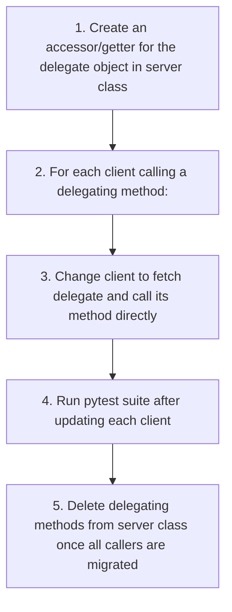

# Remove Middle Man 🚪

## Source Reference
* **Book:** *Dive Into Refactoring* (Alexander Shvets), Chapter: *Refactoring Techniques / Moving Features between Objects / Remove Middle Man*
* **Fixes Code Smells:** [Middle Man](../../code-smells/couplers/middle-man.md)
* **Target Language:** Modern Python 3 (Python 3.10+) with `pytest`.

---

## 1. Intent and Motivation

A class has **too many methods that simply delegate to other objects**. **Make the client call the delegate object directly and delete the pass-through methods.**

Remove Middle Man is the direct inverse of [Hide Delegate](hide-delegate.md). When encapsulation has gone too far, every new method added to a delegate forces you to write a mirrored method in the parent class. Removing the middleman eliminates this boilerplate.

---

## 2. Step-by-Step Mechanics



1. **Expose Delegate:** Provide a property or getter method to retrieve the delegate object.
2. **Update Clients:** Adjust callers to fetch the delegate and invoke its methods directly.
3. **Run Tests:** Run `pytest` after each client update.
4. **Remove Delegates:** Delete the empty forwarding methods from the server class.

---

## 3. Python Before & After Demonstration

### A. Smelly / Legacy Code (Server Overwhelmed by Forwarding Boilerplate)
```python
# middleman_smelly.py
class Department:

  def __init__(self, manager: str, budget_code: str, cost_center: str) -> None:
    self.manager = manager
    self.budget_code = budget_code
    self.cost_center = cost_center


class Person:
  """Smelly: Middle Man bloated with pass-through forwarding methods."""

  def __init__(self, name: str, department: Department) -> None:
    self.name = name
    self._department = department

  @property
  def manager(self) -> str:
    return self._department.manager

  @property
  def budget_code(self) -> str:
    return self._department.budget_code

  @property
  def cost_center(self) -> str:
    return self._department.cost_center
```

### B. Pytest Baseline Contract
```python
# test_middleman.py
from middleman_smelly import Department, Person


def test_person_department_info():
  dept = Department("Dr. Strange", "SANCTUM-1", "CC-99")
  person = Person("Wong", dept)

  assert person.manager == "Dr. Strange"
  assert person.budget_code == "SANCTUM-1"
  assert person.cost_center == "CC-99"
```

### C. Refactored Clean Code (Remove Middle Man)
```python
# middleman_clean.py
class Department:

  def __init__(self, manager: str, budget_code: str, cost_center: str) -> None:
    self.manager = manager
    self.budget_code = budget_code
    self.cost_center = cost_center


class Person:
  """Clean class: Focuses strictly on Person state; exposes Department directly."""

  def __init__(self, name: str, department: Department) -> None:
    self.name = name
    self.department = department  # Directly accessible
```

---

## 4. Complexity, Trade-offs & Anti-patterns

* **Balance Demeter vs Middle Man:** There is no single rule for how much delegation is appropriate. If a class delegates 1 or 2 core methods, hiding the delegate is clean. When it delegates 15 methods and adds no behavior of its own, remove the middleman.

---

## 5. Related Techniques & Design Patterns

* **Opposite:** [Hide Delegate](hide-delegate.md).
* **Companion:** [Inline Class](inline-class.md).
