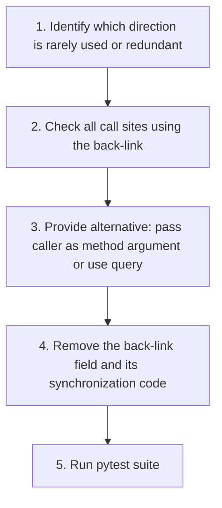

# Change Bidirectional Association to Unidirectional ✂️

## Source Reference
* **Book:** *Dive Into Refactoring* (Alexander Shvets), Chapter: *Refactoring Techniques / Organizing Data / Change Bidirectional Association to Unidirectional*
* **Fixes Code Smells:** [Inappropriate Intimacy](../../code-smells/couplers/inappropriate-intimacy.md)
* **Target Language:** Modern Python 3 (Python 3.10+) with `pytest`.

---

## 1. Intent and Motivation

You have a bidirectional association between two classes, but **one of the classes no longer uses or needs the reference to the other**. **Drop the unneeded association to reduce coupling and prevent cyclic dependencies.**

Bidirectional associations are expensive: they make classes harder to test in isolation, complicate serialization, introduce cyclic memory loops, and invite [Inappropriate Intimacy](../../code-smells/couplers/inappropriate-intimacy.md). If `Customer` rarely needs to navigate to `Order`, eliminate the back-link.

---

## 2. Step-by-Step Mechanics



1. **Verify Direction:** Determine which link is unnecessary.
2. **Alternative Navigation:** If a method in Class B needs Class A only momentarily, pass Class A as a method argument rather than storing a permanent field.
3. **Remove Field:** Delete the back-pointer attribute and all sync logic.
4. **Test:** Run tests.

---

## 3. Python Before & After Demonstration

### A. Smelly / Legacy Code (Order Intimately Tied to Customer and Vice Versa)
```python
# cycle_smelly.py
class Customer:

  def __init__(self, name: str) -> None:
    self.name = name
    self.orders = []


class Order:

  def __init__(self, order_id: str, customer: Customer) -> None:
    self.order_id = order_id
    self.customer = customer
    # Bidirectional back-pointer:
    self.customer.orders.append(self)
```

### B. Pytest Baseline Contract
```python
# test_cycle.py
from cycle_smelly import Customer, Order


def test_bidirectional_coupling():
  cust = Customer("Alice")
  order = Order("ORD-1", cust)
  assert order in cust.orders
```

### C. Refactored Clean Code (Unidirectional Association)
```python
# cycle_clean.py
class Customer:
  """Clean entity: completely decoupled from Order lifecycle."""

  def __init__(self, name: str) -> None:
    self.name = name


class Order:
  """Order holds clean one-way reference to Customer."""

  def __init__(self, order_id: str, customer: Customer) -> None:
    self.order_id = order_id
    self.customer = customer


# If customer's orders are ever needed, query them via a separate Repository / Service:
class OrderQueryService:

  def find_orders_for_customer(
      self, customer: Customer, all_orders: list[Order]
  ) -> list[Order]:
    return [o for o in all_orders if o.customer is customer]
```

---

## 4. Complexity, Trade-offs & Anti-patterns

* **Performance Querying:** Dropping the back-link means you cannot simply do `customer.orders`. If you need all orders for a customer frequently, use an external query service or database index instead of in-memory object graph entanglement.

---

## 5. Related Techniques & Design Patterns

* **Opposite:** [Change Unidirectional Association to Bidirectional](change-unidirectional-to-bidirectional.md).
