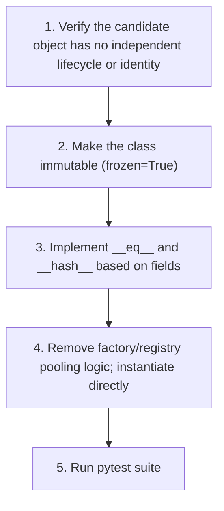

# Change Reference to Value 💠

## Source Reference
* **Book:** *Dive Into Refactoring* (Alexander Shvets), Chapter: *Refactoring Techniques / Organizing Data / Change Reference to Value*
* **Design Pattern Bridge:** *Value Object* (Domain-Driven Design)
* **Target Language:** Modern Python 3 (Python 3.10+) with `pytest`.

---

## 1. Intent and Motivation

You have a reference object that is small, contains simple data, and its **identity does not matter; only its values matter**. Managing it through complex registries, identity trackers, or shared pointers is awkward and bug-prone.

**Turn it into an immutable Value Object.** In Python, use `@dataclass(frozen=True)` or `NamedTuple` and implement structural equality (`__eq__` and `__hash__`).

---

## 2. Step-by-Step Mechanics



1. **Verify Immutability:** Ensure the object does not need to mutate state after instantiation.
2. **Make Immutable:** Decorate with `@dataclass(frozen=True)` and remove all setter methods.
3. **Value Equality:** Ensure two instances with identical attributes compare as equal: `Point(1, 2) == Point(1, 2)`.
4. **Remove Registries:** Stop tracking instances in memory pools or identity registries.

---

## 3. Python Before & After Demonstration

### A. Smelly / Legacy Code (Over-Engineered Reference Object for Currency/Money)
```python
# money_ref_smelly.py
class Currency:
  """Smelly: Treated as a mutable reference entity requiring shared IDs."""

  def __init__(self, code: str) -> None:
    self.code = code


# Comparing two currencies required checking memory IDs!
c1 = Currency("USD")
c2 = Currency("USD")
# c1 == c2 evaluates to False!
```

### B. Pytest Baseline Contract
```python
# test_currency.py
from money_ref_smelly import Currency


def test_reference_equality_fails_by_default():
  c1 = Currency("USD")
  c2 = Currency("USD")
  assert c1 != c2  # Reference inequality
```

### C. Refactored Clean Code (Immutable Value Object)
```python
# money_val_clean.py
from dataclasses import dataclass


@dataclass(frozen=True)
class Currency:
  """Clean Value Object: equality is based on data, not memory address."""

  code: str

  def __post_init__(self) -> None:
    object.__setattr__(self, "code", self.code.upper())


@dataclass(frozen=True)
class Money:
  """Composite Value Object."""

  amount: float
  currency: Currency

  def add(self, other: "Money") -> "Money":
    if self.currency != other.currency:
      raise ValueError("Cannot add different currencies")
    return Money(round(self.amount + other.amount, 2), self.currency)
```

---

## 4. Complexity, Trade-offs & Anti-patterns

* **Never Mutate Value Objects:** A Value Object must never modify its internal fields. Any operation (like adding money or translating coordinates) must return a **new instance**.

---

## 5. Related Techniques & Design Patterns

* **Opposite:** [Change Value to Reference](change-value-to-reference.md).
* **Companion:** [Replace Data Value with Object](replace-data-value-with-object.md).
