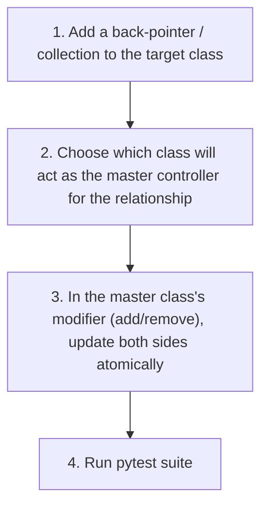

# Change Unidirectional Association to Bidirectional 🔄

## Source Reference
* **Book:** *Dive Into Refactoring* (Alexander Shvets), Chapter: *Refactoring Techniques / Organizing Data / Change Unidirectional Association to Bidirectional*
* **Target Language:** Modern Python 3 (Python 3.10+) with `pytest`.

---

## 1. Intent and Motivation

You have two classes that need to access each other's features, but currently there is only a **one-way reference** between them (e.g., `Order` references `Customer`, but `Customer` cannot easily query its list of `Orders`).

**Add the missing back-link and ensure that state updates across both objects are kept strictly in sync.**

Only add bidirectional associations when there is a genuine, frequent business need for both sides to navigate to each other.

---

## 2. Step-by-Step Mechanics



1. **Add Field:** Add a collection (e.g., `self.orders = []`) to the target class.
2. **Designate Master:** Decide which class controls the relationship (usually the parent or aggregate root, e.g., `Customer` or `Order`).
3. **Synchronize Atomically:** When an order sets its customer, it must automatically append itself to `customer.orders` and remove itself from the previous customer's orders.
4. **Test:** Verify bidirectional navigation and orphan prevention with `pytest`.

---

## 3. Python Before & After Demonstration

### A. Smelly / Legacy Code (One-Way Link Requiring Full Table Scans)
```python
# assoc_smelly.py
class Customer:

  def __init__(self, name: str) -> None:
    self.name = name
    # Smelly: Customer has no idea what orders it holds!


class Order:

  def __init__(self, order_id: str, customer: Customer) -> None:
    self.order_id = order_id
    self.customer = customer
```

### B. Pytest Baseline Contract
```python
# test_assoc.py
from assoc_smelly import Customer, Order


def test_one_way_link():
  cust = Customer("Alice")
  order = Order("ORD-1", cust)
  assert order.customer.name == "Alice"
  # Cannot query: cust.orders!
```

### C. Refactored Clean Code (Synchronized Bidirectional Association)
```python
# assoc_clean.py
class Customer:
  """Customer maintains an synchronized collection of orders."""

  def __init__(self, name: str) -> None:
    self.name = name
    self._orders: set["Order"] = set()

  @property
  def orders(self) -> frozenset["Order"]:
    return frozenset(self._orders)

  def _add_order(self, order: "Order") -> None:
    self._orders.add(order)

  def _remove_order(self, order: "Order") -> None:
    self._orders.discard(order)


class Order:
  """Order acts as the master controller synchronizing both sides."""

  def __init__(self, order_id: str, customer: Customer | None = None) -> None:
    self.order_id = order_id
    self._customer: Customer | None = None
    if customer:
      self.set_customer(customer)

  @property
  def customer(self) -> Customer | None:
    return self._customer

  def set_customer(self, new_customer: Customer | None) -> None:
    # 1. Remove from previous customer if exists
    if self._customer is not None:
      self._customer._remove_order(self)

    # 2. Assign new customer
    self._customer = new_customer

    # 3. Add to new customer if exists
    if self._customer is not None:
      self._customer._add_order(self)
```

---

## 4. Complexity, Trade-offs & Anti-patterns

* **Memory Leaks & Cyclic References:** In Python, bidirectional references can prevent timely reference-counting garbage collection (cyclic references). If one object has a short lifecycle, consider using `weakref.ref` for the back-pointer.
* **Tight Coupling:** Bidirectional associations tightly couple both classes. Only use when truly necessary.

---

## 5. Related Techniques & Design Patterns

* **Opposite:** [Change Bidirectional Association to Unidirectional](change-bidirectional-to-unidirectional.md).
