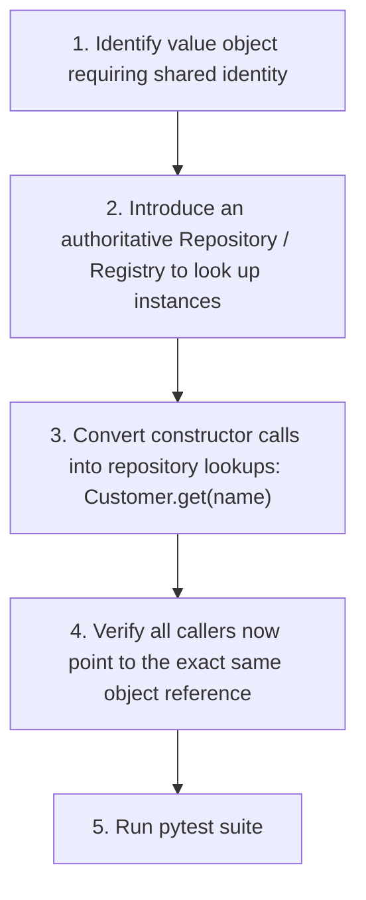

# Change Value to Reference 🔗

## Source Reference
* **Book:** *Dive Into Refactoring* (Alexander Shvets), Chapter: *Refactoring Techniques / Organizing Data / Change Value to Reference*
* **Design Pattern Bridge:** [Flyweight Pattern](../../../design-patterns/structural/flyweight.md), [Repository Pattern](../../../design-patterns/creational/factory-method.md)
* **Target Language:** Modern Python 3 (Python 3.10+) with `pytest`.

---

## 1. Intent and Motivation

You have many identical instances of a class that were created as independent value objects, but now **you need them to represent a single real-world entity with a shared mutable identity**. **Convert the value object into a reference object, managed by a Repository or Registry.**

In an e-commerce system, if two orders each instantiate their own `Customer("Alice")`, changing Alice's credit limit on one order leaves the other order unchanged. Converting `Customer` to a reference object ensures all orders refer to the exact same customer instance in memory.

---

## 2. Step-by-Step Mechanics



1. **Create Registry/Repository:** Build a repository or factory method responsible for storing and retrieving unique instances (e.g., indexed by customer ID or name).
2. **Replace Direct Instantiation:** Modify caller code or host constructors to fetch objects from the repository rather than calling `Customer(...)` directly.
3. **Test Identity:** Write a test asserting `order1.customer is order2.customer`.

---

## 3. Python Before & After Demonstration

### A. Smelly / Legacy Code (Duplicated Customer Values Without Shared State)
```python
# customer_val_smelly.py
class Customer:

  def __init__(self, name: str) -> None:
    self.name = name
    self.loyalty_points = 0


class Order:

  def __init__(self, customer_name: str, amount: float) -> None:
    # Smelly: Instantiates brand new Customer object every time!
    self.customer = Customer(customer_name)
    self.amount = amount
```

### B. Pytest Baseline Contract
```python
# test_customer_ref.py
from customer_val_smelly import Order


def test_independent_customers_are_not_linked():
  order1 = Order("Alice", 100.0)
  order2 = Order("Alice", 200.0)

  # They are two completely separate objects in memory:
  assert order1.customer is not order2.customer
```

### C. Refactored Clean Code (Shared Reference via CustomerRepository)
```python
# customer_ref_clean.py
class Customer:
  """Domain Entity with unique identity."""

  def __init__(self, name: str) -> None:
    self.name = name
    self.loyalty_points = 0

  def add_points(self, pts: int) -> None:
    self.loyalty_points += pts


class CustomerRepository:
  """Authoritative Registry maintaining single-instance identity."""

  def __init__(self) -> None:
    self._pool: dict[str, Customer] = {}

  def get_or_create(self, name: str) -> Customer:
    if name not in self._pool:
      self._pool[name] = Customer(name)
    return self._pool[name]


class Order:
  """Clean class: references shared Customer entity."""

  def __init__(
      self,
      customer_name: str,
      amount: float,
      repo: CustomerRepository,
  ) -> None:
    self.customer = repo.get_or_create(customer_name)
    self.amount = amount
```

---

## 4. Complexity, Trade-offs & Anti-patterns

* **Shared Mutation Hazards:** Once an object is a reference, modifying it affects every caller holding that reference. Ensure that business invariants around reference objects are strictly guarded.

---

## 5. Related Techniques & Design Patterns

* **Opposite:** [Change Reference to Value](change-reference-to-value.md).
* **Companion Pattern:** [Flyweight Pattern](../../../design-patterns/structural/flyweight.md).
