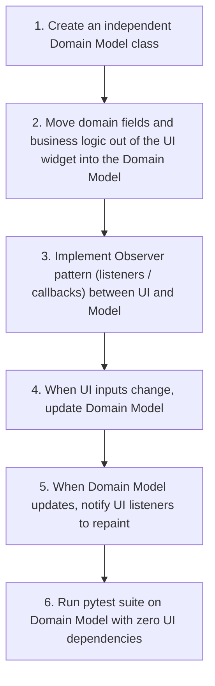

# Duplicate Observed Data 👁️

## Source Reference
* **Book:** *Dive Into Refactoring* (Alexander Shvets), Chapter: *Refactoring Techniques / Organizing Data / Duplicate Observed Data*
* **Design Pattern Bridge:** [Observer Pattern](../../../design-patterns/behavioral/observer.md), *Model-View-Controller (MVC)*
* **Target Language:** Modern Python 3 (Python 3.10+) with `pytest`.

---

## 1. Intent and Motivation

You have domain business data stored directly inside GUI widgets or presentation components (e.g., text fields, UI dropdowns), and **business methods need access to this data**.

**Separate the domain data into an independent Domain Model class. Synchronize the model and the UI using the Observer pattern.**

A program that mixes UI rendering and domain calculations cannot be tested without running a visual GUI framework, and cannot support alternate presentation interfaces (like a REST API or CLI).

---

## 2. Step-by-Step Mechanics



1. **Create Domain Model:** Build a pure Python class containing the core business fields and calculations.
2. **Move Business Calculations:** Strip all calculation logic out of the presentation component and relocate it to the model.
3. **Connect via Observer:** Have the UI register as an observer of the Domain Model.
4. **Test Domain Separately:** Write unit tests against the Domain Model without importing any GUI libraries.

---

## 3. Python Before & After Demonstration

### A. Smelly / Legacy Code (Domain Calculation Trapped Inside UI View)
```python
# view_smelly.py
class MockUiTextField:

  def __init__(self, text: str = "") -> None:
    self.text = text


class OrderWindow:
  """Smelly: Business rules trapped inside presentation UI component."""

  def __init__(self) -> None:
    self.txt_item_price = MockUiTextField("100.0")
    self.txt_quantity = MockUiTextField("2")
    self.txt_total = MockUiTextField()

  def on_calculate_button_clicked(self) -> None:
    # Business logic trapped inside GUI event handler!
    price = float(self.txt_item_price.text)
    qty = int(self.txt_quantity.text)
    total = price * qty
    if total > 500:
      total *= 0.90
    self.txt_total.text = f"${total:.2f}"
```

### B. Pytest Baseline Contract
```python
# test_view.py
from view_smelly import OrderWindow


def test_ui_total_calculation():
  window = OrderWindow()
  window.on_calculate_button_clicked()
  assert window.txt_total.text == "$200.00"
```

### C. Refactored Clean Code (Separated Domain Model + Observer Sync)
```python
# view_clean.py
from typing import Callable


class OrderModel:
  """Pure Domain Model: Zero GUI dependencies; 100% testable in isolation."""

  def __init__(
      self, unit_price: float = 0.0, quantity: int = 0
  ) -> None:
    self._unit_price = unit_price
    self._quantity = quantity
    self._listeners: list[Callable[["OrderModel"], None]] = []

  def subscribe(self, listener: Callable[["OrderModel"], None]) -> None:
    self._listeners.append(listener)

  def _notify(self) -> None:
    for listener in self._listeners:
      listener(self)

  def update(self, unit_price: float, quantity: int) -> None:
    self._unit_price = unit_price
    self._quantity = quantity
    self._notify()

  @property
  def total(self) -> float:
    subtotal = self._unit_price * self._quantity
    return subtotal * 0.90 if subtotal > 500.0 else subtotal


class OrderWindow:
  """Clean View: Observes Domain Model and updates visual fields."""

  def __init__(self, model: OrderModel) -> None:
    self.model = model
    self.display_total = ""
    # Subscribe UI updater to domain events:
    self.model.subscribe(self._on_model_changed)

  def _on_model_changed(self, model: OrderModel) -> None:
    self.display_total = f"${model.total:.2f}"
```

---

## 4. Complexity, Trade-offs & Anti-patterns

* **Event Loops & Cycles:** Be careful not to create infinite event loops where updating the UI updates the Model, which notifies the UI, which updates the Model again. Guard with dirty checks.

---

## 5. Related Techniques & Design Patterns

* **Companion Pattern:** [Observer Pattern](../../../design-patterns/behavioral/observer.md).
* **Architecture:** *Model-View-Controller (MVC)*, *Hexagonal Architecture*.
