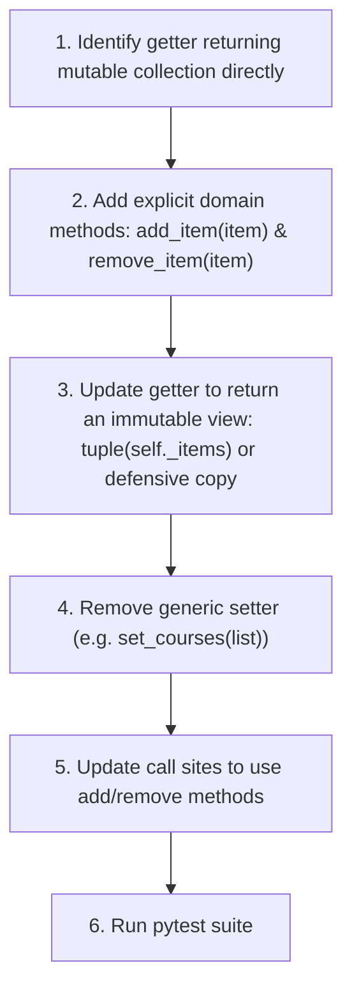

# Encapsulate Collection 🛡️

## Source Reference
* **Book:** *Dive Into Refactoring* (Alexander Shvets), Chapter: *Refactoring Techniques / Organizing Data / Encapsulate Collection*
* **Design Principle Bridge:** *Information Hiding*, *Encapsulation*
* **Fixes Code Smells:** [Inappropriate Intimacy](../../code-smells/couplers/inappropriate-intimacy.md)
* **Target Language:** Modern Python 3 (Python 3.10+) with `pytest`.

---

## 1. Intent and Motivation

A class contains a collection field (a `list`, `set`, or `dict`), and provides a getter and setter that directly exposes this mutable collection to external callers.

**Make the getter return an immutable copy (or read-only view like `tuple` or `MappingProxyType`), and provide explicit methods for adding and removing elements.**

If a method returns a mutable reference to an internal list (`return self._courses`), callers can call `.append()` or `.clear()` directly behind the class's back, completely bypassing validation or business notifications.

---

## 2. Step-by-Step Mechanics



1. **Add Modifier Methods:** Add `add_item(item)` and `remove_item(item)` with necessary business validation checks.
2. **Defensive View:** Update the collection property to return a `tuple(self._collection)` or `frozenset`.
3. **Remove Collection Setter:** Delete any setter that allows replacing the entire collection wholesale.
4. **Test:** Run tests.

---

## 3. Python Before & After Demonstration

### A. Smelly / Legacy Code (Direct Access to Internal Mutable List)
```python
# course_smelly.py
class Student:

  def __init__(self, name: str) -> None:
    self.name = name
    self.courses: list[str] = []  # Exposed directly!
```

### B. Pytest Baseline Contract
```python
# test_course.py
from course_smelly import Student


def test_student_courses():
  student = Student("Harry Potter")
  # External code mutates collection directly:
  student.courses.append("Potions")
  assert "Potions" in student.courses
```

### C. Refactored Clean Code (Encapsulated Collection with Tuple View)
```python
# course_clean.py
class Student:
  """Clean entity: collection state is protected against unauthorized external modification."""

  def __init__(self, name: str) -> None:
    self.name = name
    self._courses: list[str] = []

  @property
  def courses(self) -> tuple[str, ...]:
    """Returns an immutable tuple: external callers cannot .append() or .clear()!"""
    return tuple(self._courses)

  def enroll(self, course_name: str) -> None:
    clean_name = course_name.strip()
    if not clean_name:
      raise ValueError("Course name cannot be empty")
    if clean_name in self._courses:
      raise ValueError(f"Already enrolled in {clean_name}")
    if len(self._courses) >= 6:
      raise ValueError("Maximum course load is 6 courses")

    self._courses.append(clean_name)

  def drop(self, course_name: str) -> None:
    if course_name not in self._courses:
      raise ValueError(f"Cannot drop unenrolled course: {course_name}")
    self._courses.remove(course_name)
```

---

## 4. Complexity, Trade-offs & Anti-patterns

* **Python Immutability Helpers:**
  - Lists: return `tuple(self._items)`.
  - Sets: return `frozenset(self._items)`.
  - Dictionaries: return `types.MappingProxyType(self._dict)`.

---

## 5. Related Techniques & Design Patterns

* **Companion:** [Encapsulate Field](encapsulate-field.md).
