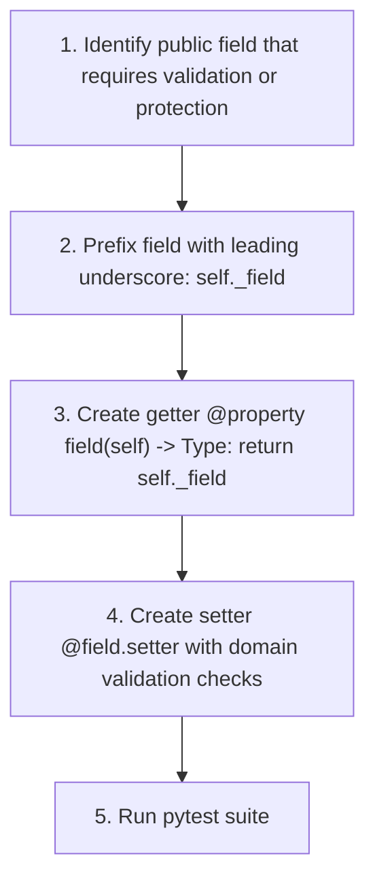

# Encapsulate Field 🔒

## Source Reference
* **Book:** *Dive Into Refactoring* (Alexander Shvets), Chapter: *Refactoring Techniques / Organizing Data / Encapsulate Field*
* **Design Principle Bridge:** *Information Hiding*, *Encapsulation*
* **Fixes Code Smells:** [Inappropriate Intimacy](../../code-smells/couplers/inappropriate-intimacy.md), [Data Class](../../code-smells/dispensables/data-class.md)
* **Target Language:** Modern Python 3 (Python 3.10+) with `pytest`.

---

## 1. Intent and Motivation

You have a **public field that can be directly read and modified by any caller across the codebase**. **Make the field private (prefixed with `_` in Python) and create property accessors (`@property` and `@prop.setter`) to control access and enforce invariants.**

When public attributes are directly exposed, any rogue piece of code can assign invalid data (e.g., negative balances or empty strings) without the object having a say. Encapsulating the field restores the object's ability to guard its invariants.

---

## 2. Step-by-Step Mechanics



1. **Prefix with Underscore:** Rename `self.field` to `self._field`.
2. **Add Property Getter:** Define `@property def field(self): return self._field`.
3. **Add Property Setter:** Define `@field.setter` and add invariant validation.
4. **Test:** Run tests. External callers continue accessing `obj.field = val` with zero API break!

---

## 3. Python Before & After Demonstration

### A. Smelly / Legacy Code (Public Attribute Subject to Invalid State)
```python
# account_smelly.py
class BankAccount:

  def __init__(self, initial_balance: float) -> None:
    # Public attribute: Any caller can execute: account.balance = -999999!
    self.balance = initial_balance
```

### B. Pytest Baseline Contract
```python
# test_account.py
from account_smelly import BankAccount


def test_public_field_mutation():
  acc = BankAccount(100.0)
  acc.balance = 150.0
  assert acc.balance == 150.0
```

### C. Refactored Clean Code (Encapsulated Property with Invariants)
```python
# account_clean.py
class BankAccount:
  """Clean class: balance is strictly encapsulated with invariant validation."""

  def __init__(self, initial_balance: float) -> None:
    self._balance = 0.0
    self.balance = initial_balance  # Routes through setter validation

  @property
  def balance(self) -> float:
    return self._balance

  @balance.setter
  def balance(self, new_balance: float) -> None:
    if new_balance < 0.0:
      raise ValueError("Account balance cannot be negative!")
    self._balance = round(new_balance, 2)
```

---

## 4. Complexity, Trade-offs & Anti-patterns

* **Pythonic Pragmatism:** In Python, it is standard practice to use simple public attributes until validation, caching, or notification is actually needed. Python's `@property` decorator allows you to encapsulate a public field later without breaking backward compatibility for callers.

---

## 5. Related Techniques & Design Patterns

* **Companion:** [Self Encapsulate Field](self-encapsulate-field.md), [Encapsulate Collection](encapsulate-collection.md).
