# Organizing Data 🗃️

## Source Reference
* **Book:** *Dive Into Refactoring* (Alexander Shvets), Chapter: *Refactoring Techniques / Organizing Data*
* **Target Language:** Modern Python 3 (Python 3.10+) with `pytest`.

---

## Overview

Data structures form the backbone of any software program. Smells often emerge when data is poorly organized: using primitive strings and integers instead of domain objects, exposing mutable collections directly, hardcoding magic numbers, or entangling classes with messy bidirectional pointers.

The techniques in this group replace crude data structures with rich, encapsulated objects and establish clear ownership.

```mermaid
graph TD
    OD["Organizing Data"]
    OD --> Encaps["Encapsulation"]
    Encaps --> SEF["Self Encapsulate Field"]
    Encaps --> EF["Encapsulate Field"]
    Encaps --> EC["Encapsulate Collection"]
    
    OD --> ValueRef["Values & References"]
    ValueRef --> RDVO["Replace Data Value with Object"]
    ValueRef --> CVR["Change Value to Reference"]
    ValueRef --> CRV["Change Reference to Value"]
    ValueRef --> RAO["Replace Array/Dict with Object"]
    ValueRef --> RMN["Replace Magic Number with Symbolic Constant"]
    
    OD --> Assoc["Associations"]
    Assoc --> CUB["Change Unidirectional to Bidirectional"]
    Assoc --> CBU["Change Bidirectional to Unidirectional"]
    Assoc --> DOD["Duplicate Observed Data (Observer Bridge)"]
    
    OD --> TypeCodes["Replacing Type Codes"]
    TypeCodes --> RTCClass["Replace Type Code with Class / Enum"]
    TypeCodes --> RTCSub["Replace Type Code with Subclasses"]
    TypeCodes --> RTCSS["Replace Type Code with State/Strategy"]
    TypeCodes --> RSF["Replace Subclass with Fields"]
```

---

## The 15 Techniques in this Group

| Technique | Problem Solved | Core Transformation |
| :--- | :--- | :--- |
| [**Self Encapsulate Field**](self-encapsulate-field.md) | Accessing instance variables directly inside class | Use property getters/setters even internally |
| [**Replace Data Value with Object**](replace-data-value-with-object.md) | Primitive field needs extra data or behavior | Turn primitive field into a dedicated class/dataclass |
| [**Change Value to Reference**](change-value-to-reference.md) | Multiple identical value objects should share identity | Convert into a shared reference via Repository/Registry |
| [**Change Reference to Value**](change-reference-to-value.md) | Reference object is small, immutable, and identity doesn't matter | Turn into an immutable Value Object (`frozen=True`) |
| [**Replace Array/Dict with Object**](replace-array-with-object.md) | Array or dict elements represent distinct conceptual fields | Create class with named fields for each element |
| [**Duplicate Observed Data**](duplicate-observed-data.md) | Domain data trapped inside GUI/Presentation elements | Separate domain into Model and synchronize via Observer |
| [**Change Unidirectional to Bidirectional**](change-unidirectional-to-bidirectional.md) | Two classes need each other's features but only one has link | Add back-pointer and maintain both sides cleanly |
| [**Change Bidirectional to Unidirectional**](change-bidirectional-to-unidirectional.md) | Two classes have mutual links but one no longer needs it | Remove the unneeded back-link to decouple classes |
| [**Replace Magic Number with Symbolic Constant**](replace-magic-number.md) | Raw literal numbers with special meaning scattered in code | Replace literals with named constants |
| [**Encapsulate Field**](encapsulate-field.md) | Public fields accessed and mutated arbitrarily | Make field private (`_field`) and provide property accessors |
| [**Encapsulate Collection**](encapsulate-collection.md) | Method returns a mutable list/dict directly | Return read-only copy and provide add/remove methods |
| [**Replace Type Code with Class**](replace-type-code-with-class.md) | Primitive integer/string type codes control behavior | Replace with Python `Enum` or class |
| [**Replace Type Code with Subclasses**](replace-type-code-with-subclasses.md) | Type code directly dictates class behavior | Create subclasses for each type code value |
| [**Replace Type Code with State/Strategy**](replace-type-code-with-state-strategy.md) | Type code changes at runtime or class already has parent | Move type-dependent behavior to State/Strategy object |
| [**Replace Subclass with Fields**](replace-subclass-with-fields.md) | Subclasses differ only in constant return values | Eliminate subclasses and pass constant as field to parent |
