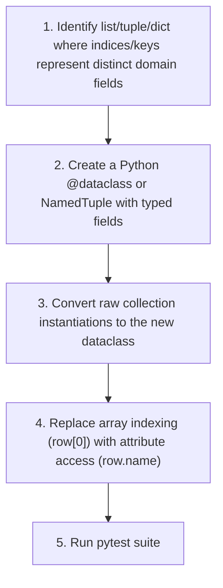

# Replace Array / Dictionary with Object 🗂️

## Source Reference
* **Book:** *Dive Into Refactoring* (Alexander Shvets), Chapter: *Refactoring Techniques / Organizing Data / Replace Array with Object*
* **Fixes Code Smells:** [Primitive Obsession](../../code-smells/bloaters/primitive-obsession.md)
* **Target Language:** Modern Python 3 (Python 3.10+) with `pytest`.

---

## 1. Intent and Motivation

You have an array, list, or dictionary where **different elements represent distinct pieces of data** (e.g., `row[0]` is customer name, `row[1]` is wins, `row[2]` is losses). **Replace the array or raw dictionary with a dedicated class that has a field for each element.**

Using lists or loose dictionaries to represent structured domain records is a classic form of Primitive Obsession. Readers must memorize magical integer indices (`row[3]`) or string keys, and typos cause runtime `KeyError` or index out-of-range crashes.

---

## 2. Step-by-Step Mechanics



1. **Create Dataclass:** Define a `@dataclass` with clear, type-hinted attribute names.
2. **Factory Method:** If data arrives as raw CSV rows or JSON dictionaries, add a class method `from_row(cls, row: list)` or `from_dict(cls, data: dict)`.
3. **Replace Indexing:** Replace `row[0]` with `record.name`.
4. **Test:** Verify with `pytest`.

---

## 3. Python Before & After Demonstration

### A. Smelly / Legacy Code (Magic Array Indices Representing Sports Team Data)
```python
# sports_smelly.py
def process_team_record(row: list) -> str:
  # row[0] = Team Name, row[1] = Wins, row[2] = Losses
  win_rate = row[1] / (row[1] + row[2])
  return f"{row[0]}: {win_rate:.1%}"
```

### B. Pytest Baseline Contract
```python
# test_sports.py
from sports_smelly import process_team_record


def test_team_record():
  # Passing raw list where order is critical:
  row = ["Warriors", 15, 5]
  assert process_team_record(row) == "Warriors: 75.0%"
```

### C. Refactored Clean Code (Typed Domain Dataclass)
```python
# sports_clean.py
from dataclasses import dataclass


@dataclass(frozen=True)
class TeamRecord:
  """Clean entity: Replaces magical array positions with self-documenting attributes."""

  team_name: str
  wins: int
  losses: int

  @classmethod
  def from_row(cls, row: list) -> "TeamRecord":
    return cls(team_name=str(row[0]), wins=int(row[1]), losses=int(row[2]))

  @property
  def total_games(self) -> int:
    return self.wins + self.losses

  @property
  def win_percentage(self) -> float:
    if self.total_games == 0:
      return 0.0
    return self.wins / self.total_games

  @property
  def summary(self) -> str:
    return f"{self.team_name}: {self.win_percentage:.1%}"


def process_team_record(record: TeamRecord) -> str:
  return record.summary
```

---

## 4. Complexity, Trade-offs & Anti-patterns

* **External CSV / API Parsers:** Keep parsing logic cleanly isolated in `.from_row()` or `.from_dict()` constructors so that internal application code is never exposed to raw array indices.

---

## 5. Related Techniques & Design Patterns

* **Companion:** [Replace Data Value with Object](replace-data-value-with-object.md).
* **Fixes:** [Primitive Obsession](../../code-smells/bloaters/primitive-obsession.md).
