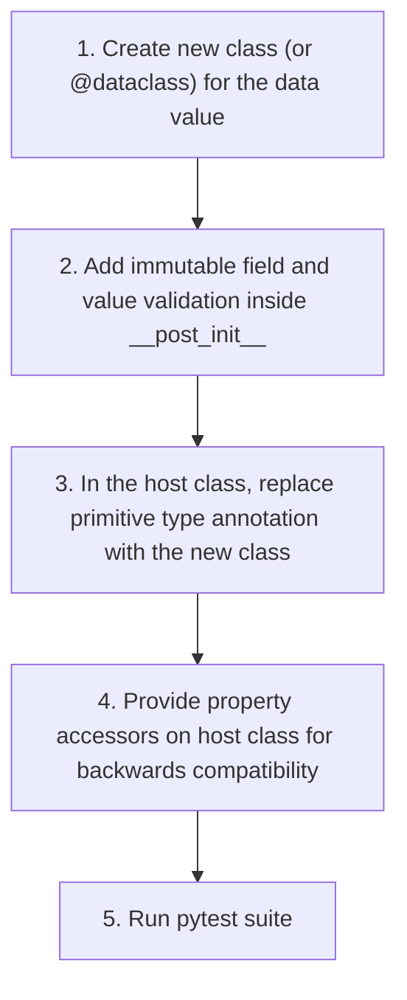

# Replace Data Value with Object 💎

## Source Reference
* **Book:** *Dive Into Refactoring* (Alexander Shvets), Chapter: *Refactoring Techniques / Organizing Data / Replace Data Value with Object*
* **Design Pattern Bridge:** *Value Object* (Domain-Driven Design)
* **Fixes Code Smells:** [Primitive Obsession](../../code-smells/bloaters/primitive-obsession.md)
* **Target Language:** Modern Python 3 (Python 3.10+) with `pytest`.

---

## 1. Intent and Motivation

A class has a primitive data field (e.g., a customer name string `customer: str` or a phone number string) that **needs additional data or custom behaviors (validation, formatting, equality)**. **Turn the data field into a new class and store an instance of this class instead of the primitive.**

At the start of a project, simple strings or numbers suffice. But as business requirements grow, "just a string" starts demanding validation, parsing, and special comparison rules. Promoting primitives to first-class domain objects cures Primitive Obsession.

---

## 2. Step-by-Step Mechanics



1. **Create Value Class:** Define a dedicated class (e.g., `@dataclass(frozen=True)`).
2. **Move Validation:** Put input validation, normalization, and formatting directly into the value class.
3. **Replace in Host:** Update the host class to accept and store the value object.
4. **Preserve Compatibility:** If callers pass raw strings, convert them inside the host constructor or provide a transition property.
5. **Test:** Verify with `pytest`.

---

## 3. Python Before & After Demonstration

### A. Smelly / Legacy Code (Order Holding Raw String for Customer)
```python
# order_smelly.py
class Order:

  def __init__(self, customer_name: str, amount: float) -> None:
    # Smelly: customer is just a raw, unvalidated string
    self.customer_name = customer_name
    self.amount = amount
```

### B. Pytest Baseline Contract
```python
# test_order.py
from order_smelly import Order


def test_order_creation():
  order = Order("Bruce Wayne", 500.0)
  assert order.customer_name == "Bruce Wayne"
```

### C. Refactored Clean Code (Customer Promoted to Domain Object)
```python
# order_clean.py
from dataclasses import dataclass


@dataclass(frozen=True)
class Customer:
  """Extracted Value Object encapsulating customer identity and validation."""

  name: str

  def __post_init__(self) -> None:
    if not self.name.strip():
      raise ValueError("Customer name cannot be empty.")

  @property
  def uppercase_display(self) -> str:
    return self.name.upper()


class Order:
  """Clean class: operates with rich Customer object instead of raw string."""

  def __init__(self, customer: Customer | str, amount: float) -> None:
    # Flexible constructor: gracefully converts raw string if supplied
    self._customer = (
        Customer(customer) if isinstance(customer, str) else customer
    )
    self.amount = amount

  @property
  def customer(self) -> Customer:
    return self._customer

  @property
  def customer_name(self) -> str:
    """Backwards-compatible accessor for existing callers."""
    return self._customer.name
```

---

## 4. Complexity, Trade-offs & Anti-patterns

* **Value Object Immutability:** Value objects created with this technique should almost always be immutable (`@dataclass(frozen=True)`). Two customers or money values with the same data should evaluate as equal (`__eq__`).

---

## 5. Related Techniques & Design Patterns

* **Next Steps:** [Change Value to Reference](change-value-to-reference.md).
* **Fixes:** [Primitive Obsession](../../code-smells/bloaters/primitive-obsession.md).
