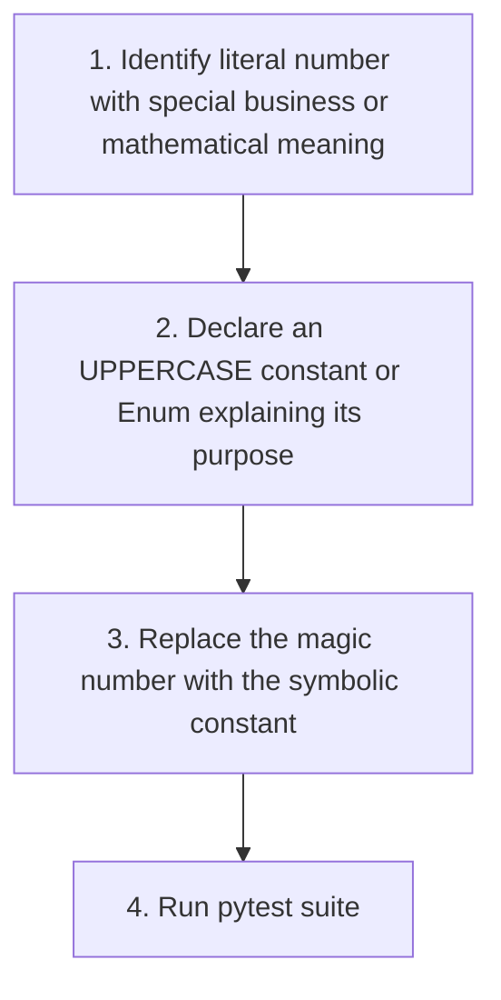

# Replace Magic Number with Symbolic Constant 🔢

## Source Reference
* **Book:** *Dive Into Refactoring* (Alexander Shvets), Chapter: *Refactoring Techniques / Organizing Data / Replace Magic Number with Symbolic Constant*
* **Target Language:** Modern Python 3 (Python 3.10+) with `pytest`.

---

## 1. Intent and Motivation

Your code contains a **raw literal number with a special meaning** (e.g., `86400`, `9.81`, `3.14159`, or a status code `2`). **Replace the number with a human-readable constant that explains its purpose.**

Magic numbers are notorious for causing subtle bugs. If the number `86400` appears in 5 files, an engineer reading the code must deduce that it represents seconds in a day. Even worse, if a number like `10` represents both a maximum retry count in one place and a tax percentage in another, global search-and-replace is impossible.

---

## 2. Step-by-Step Mechanics



1. **Declare Constant:** Create a descriptive, uppercase constant (e.g., `SECONDS_PER_DAY = 86_400` or `GRAVITATIONAL_CONSTANT = 9.81`).
2. **Replace Occurrences:** Replace literal occurrences with the named constant.
3. **Group in Enums:** If several numbers represent a closed set of choices (e.g., user tiers or status flags), group them inside a Python `enum.IntEnum`.
4. **Test:** Run `pytest`.

---

## 3. Python Before & After Demonstration

### A. Smelly / Legacy Code (Cryptic Literals Scattered in Calculations)
```python
# physics_smelly.py
def calculate_potential_energy(mass_kg: float, height_m: float) -> float:
  # What is 9.81?
  return mass_kg * 9.81 * height_m


def calculate_token_expiration(timestamp_seconds: int) -> int:
  # What is 86400?
  return timestamp_seconds + 86400
```

### B. Pytest Baseline Contract
```python
# test_physics.py
from physics_smelly import (
    calculate_potential_energy,
    calculate_token_expiration,
)


def test_calculations():
  assert calculate_potential_energy(10.0, 5.0) == 490.5
  assert calculate_token_expiration(1000) == 87400
```

### C. Refactored Clean Code (Named Constants)
```python
# physics_clean.py
STANDARD_GRAVITY_M_PER_S2: float = 9.81
SECONDS_PER_DAY: int = 86_400


def calculate_potential_energy(mass_kg: float, height_m: float) -> float:
  return mass_kg * STANDARD_GRAVITY_M_PER_S2 * height_m


def calculate_token_expiration(timestamp_seconds: int) -> int:
  return timestamp_seconds + SECONDS_PER_DAY
```

---

## 4. Complexity, Trade-offs & Anti-patterns

* **When NOT to Replace:** Do not replace self-evident numerical constants like `0` in `range(0, 10)` or `1` in incrementing a counter (`count += 1`), or `2` in calculating average `(a + b) / 2`.

---

## 5. Related Techniques & Design Patterns

* **Companion:** [Replace Type Code with Class](replace-type-code-with-class.md).
