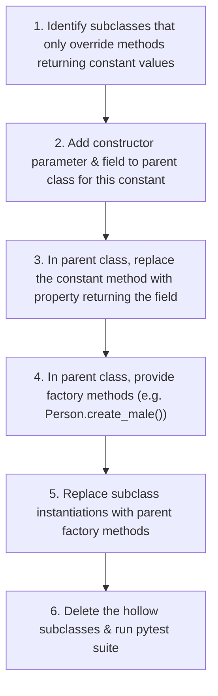

# Replace Subclass with Fields 🌿

## Source Reference
* **Book:** *Dive Into Refactoring* (Alexander Shvets), Chapter: *Refactoring Techniques / Organizing Data / Replace Subclass with Fields*
* **Fixes Code Smells:** [Lazy Class](../../code-smells/dispensables/lazy-class.md), [Speculative Generality](../../code-smells/dispensables/speculative-generality.md)
* **Target Language:** Modern Python 3 (Python 3.10+) with `pytest`.

---

## 1. Intent and Motivation

You have several subclasses whose **only difference is that they override a method to return a hardcoded constant value**.

**Replace the constant-returning methods with fields in the parent class, initialize the fields via the constructor, and delete the redundant subclasses.**

Creating entire subclasses just to return `"M"` vs `"F"` or `True` vs `False` adds unnecessary class hierarchy bloat without providing distinct behavioral logic.

---

## 2. Step-by-Step Mechanics



1. **Add Field to Parent:** Define an attribute on the superclass to hold the constant.
2. **Initialize via Constructor:** Pass the constant value into the superclass constructor.
3. **Add Factory Methods:** Provide clear factory methods on the parent (e.g., `Person.create_male(name)`).
4. **Delete Subclasses:** Remove the empty subclasses.
5. **Test:** Verify with `pytest`.

---

## 3. Python Before & After Demonstration

### A. Smelly / Legacy Code (Hollow Subclasses Returning Hardcoded Codes)
```python
# gender_smelly.py
class Person:

  def __init__(self, name: str) -> None:
    self.name = name

  def get_gender_code(self) -> str:
    raise NotImplementedError


# Smelly: Subclasses exist solely to return a single constant string!
class Male(Person):

  def get_gender_code(self) -> str:
    return "M"


class Female(Person):

  def get_gender_code(self) -> str:
    return "F"
```

### B. Pytest Baseline Contract
```python
# test_gender.py
from gender_smelly import Female, Male


def test_gender_subclasses():
  m = Male("John")
  f = Female("Mary")
  assert m.get_gender_code() == "M"
  assert f.get_gender_code() == "F"
```

### C. Refactored Clean Code (Field on Parent + Factory Methods)
```python
# gender_clean.py
class Person:
  """Clean class: eliminates hollow subclasses in favor of a constant field."""

  def __init__(self, name: str, gender_code: str) -> None:
    self.name = name
    self._gender_code = gender_code

  @property
  def gender_code(self) -> str:
    return self._gender_code

  @classmethod
  def create_male(cls, name: str) -> "Person":
    return cls(name, "M")

  @classmethod
  def create_female(cls, name: str) -> "Person":
    return cls(name, "F")
```

---

## 4. Complexity, Trade-offs & Anti-patterns

* **When NOT to Use:** If subclasses contain genuine, divergent business algorithms or calculations (not just static constants), retain the subclasses.

---

## 5. Related Techniques & Design Patterns

* **Opposite:** [Replace Type Code with Subclasses](replace-type-code-with-subclasses.md).
* **Companion:** [Collapse Hierarchy](../generalization/collapse-hierarchy.md).
