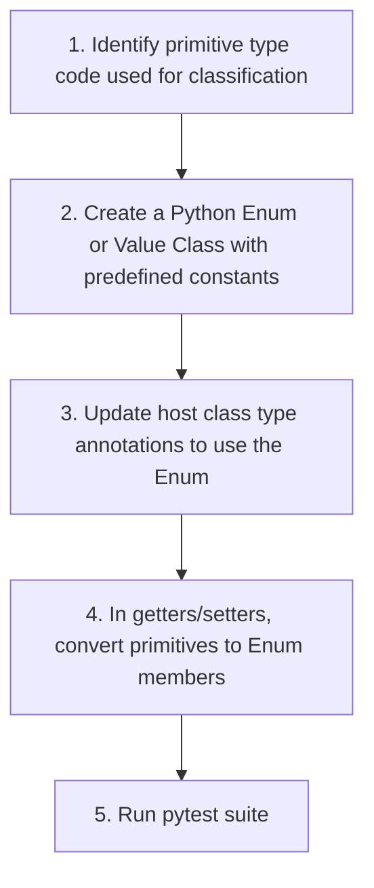

# Replace Type Code with Class / Enum 🏷️

## Source Reference
* **Book:** *Dive Into Refactoring* (Alexander Shvets), Chapter: *Refactoring Techniques / Organizing Data / Replace Type Code with Class*
* **Fixes Code Smells:** [Primitive Obsession](../../code-smells/bloaters/primitive-obsession.md)
* **Target Language:** Modern Python 3 (Python 3.10+) with `pytest`.

---

## 1. Intent and Motivation

A class has a primitive type code (integers like `0, 1, 2` or strings like `"O", "A", "B", "AB"`) that represents a classification, and **this type code does not alter the behavior of the class's methods**.

**Replace the primitive type code with a Python `enum.Enum` or dedicated Value Class.**

When type codes are raw primitives, compilers and linters cannot prevent invalid values (like passing blood group `"Z"` or user level `999`). Wrapping type codes in a class or Enum provides type-safety, autocompletion, and centralized validation.

---

## 2. Step-by-Step Mechanics



1. **Create Enum/Class:** Define an `enum.Enum` or `IntEnum` with human-readable members.
2. **Update Signatures:** Replace `int` or `str` type hints on the host class with the new `Enum`.
3. **Validate:** The Python Enum automatically raises `ValueError` if an invalid value is supplied.
4. **Test:** Run tests.

---

## 3. Python Before & After Demonstration

### A. Smelly / Legacy Code (Raw String Type Codes with Zero Validation)
```python
# blood_smelly.py
class Person:
  # Smelly: blood_group is just a raw string; anyone can pass "INVALID"!

  def __init__(self, name: str, blood_group: str) -> None:
    self.name = name
    self.blood_group = blood_group
```

### B. Pytest Baseline Contract
```python
# test_blood.py
from blood_smelly import Person


def test_person_blood_group():
  p = Person("Peter", "O")
  assert p.blood_group == "O"
```

### C. Refactored Clean Code (Enum Type Safety)
```python
# blood_clean.py
from enum import Enum


class BloodGroup(Enum):
  """Strictly typed classification enum."""

  O = "O"
  A = "A"
  B = "B"
  AB = "AB"


class Person:
  """Clean class: Type code replaced with type-safe Enum."""

  def __init__(self, name: str, blood_group: BloodGroup | str) -> None:
    self.name = name
    self.blood_group = (
        BloodGroup(blood_group)
        if isinstance(blood_group, str)
        else blood_group
    )
```

---

## 4. Complexity, Trade-offs & Anti-patterns

* **When NOT to Use:** If the type code triggers conditional logic (`if type == 1: do_a() elif type == 2: do_b()`), do not use this technique. Instead, use [Replace Type Code with Subclasses](replace-type-code-with-subclasses.md) or [Replace Type Code with State/Strategy](replace-type-code-with-state-strategy.md).

---

## 5. Related Techniques & Design Patterns

* **Alternatives (when behavior varies):** [Replace Type Code with Subclasses](replace-type-code-with-subclasses.md), [Replace Type Code with State/Strategy](replace-type-code-with-state-strategy.md).
