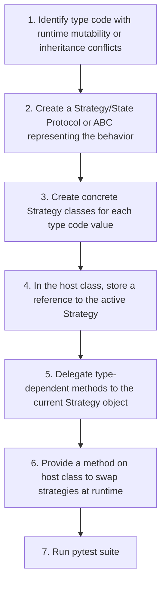

# Replace Type Code with State / Strategy 🎭

## Source Reference
* **Book:** *Dive Into Refactoring* (Alexander Shvets), Chapter: *Refactoring Techniques / Organizing Data / Replace Type Code with State/Strategy*
* **Design Pattern Bridge:** [State Pattern](../../../design-patterns/behavioral/state.md), [Strategy Pattern](../../../design-patterns/behavioral/strategy.md)
* **Fixes Code Smells:** [Switch Statements](../../code-smells/oo-abusers/switch-statements.md), [Primitive Obsession](../../code-smells/bloaters/primitive-obsession.md)
* **Target Language:** Modern Python 3 (Python 3.10+) with `pytest`.

---

## 1. Intent and Motivation

You have a type code that affects the behavior of a class, but **you cannot use subclasses because the object's type changes dynamically at runtime**, or because the host class already belongs to an existing inheritance tree.

**Replace the type code with a State or Strategy object hierarchy.**

By encapsulating the type-dependent behavior into an external State/Strategy object held as a field (`self._type_strategy`), the host object can dynamically swap its behavior at runtime simply by assigning a new strategy.

---

## 2. Step-by-Step Mechanics



1. **Create Strategy Hierarchy:** Define a `Protocol` or `ABC` with the methods whose behavior varies by type.
2. **Implement Concrete Strategies:** Build concrete classes for each variant.
3. **Compose with Host:** In the host class, replace the primitive type attribute with an instance of the strategy.
4. **Delegate:** Delegate operations to `self._strategy.compute(...)`.
5. **Runtime Transition:** Allow callers or internal logic to reassign `self._strategy = NewStrategy()`.
6. **Test:** Run tests.

---

## 3. Python Before & After Demonstration

### A. Smelly / Legacy Code (Employee Promoted at Runtime via Fragile Type Code Mutation)
```python
# promo_smelly.py
class Employee:
  ENGINEER = 1
  MANAGER = 2

  def __init__(self, emp_type: int, salary: float) -> None:
    self.type = emp_type
    self.salary = salary

  def calculate_bonus(self) -> float:
    match self.type:
      case Employee.ENGINEER:
        return self.salary * 0.10
      case Employee.MANAGER:
        return self.salary * 0.25
      case _:
        return 0.0

  def promote_to_manager(self) -> None:
    # State changes dynamically at runtime! Subclassing would fail here.
    self.type = Employee.MANAGER
```

### B. Pytest Baseline Contract
```python
# test_promo.py
from promo_smelly import Employee


def test_promotion_lifecycle():
  emp = Employee(Employee.ENGINEER, 100_000.0)
  assert emp.calculate_bonus() == 10_000.0

  emp.promote_to_manager()
  assert emp.calculate_bonus() == 25_000.0
```

### C. Refactored Clean Code (State / Strategy Pattern)
```python
# promo_clean.py
from typing import Protocol


class RoleStrategy(Protocol):
  """Strategy Protocol encapsulating compensation calculations."""

  def compute_bonus(self, salary: float) -> float:
    ...


class EngineerRole:

  def compute_bonus(self, salary: float) -> float:
    return salary * 0.10


class ManagerRole:

  def compute_bonus(self, salary: float) -> float:
    return salary * 0.25


class Employee:
  """Clean entity: delegates role calculations to a hot-swappable strategy."""

  def __init__(self, salary: float, role: RoleStrategy | None = None) -> None:
    self.salary = salary
    self._role: RoleStrategy = role or EngineerRole()

  def calculate_bonus(self) -> float:
    return self._role.compute_bonus(self.salary)

  def promote_to_manager(self) -> None:
    """Seamless runtime state transition without altering object identity!"""
    self._role = ManagerRole()
```

---

## 4. Complexity, Trade-offs & Anti-patterns

* **Strategy vs State:**
  - Use **Strategy** when algorithms vary independently and callers inject the strategy.
  - Use **State** when the object transitions automatically between states based on internal lifecycle triggers (e.g., `Draft` $\rightarrow$ `UnderReview` $\rightarrow$ `Published`).

---

## 5. Related Techniques & Design Patterns

* **Alternative (Fixed Type):** [Replace Type Code with Subclasses](replace-type-code-with-subclasses.md).
* **Companion Patterns:** [State Pattern](../../../design-patterns/behavioral/state.md), [Strategy Pattern](../../../design-patterns/behavioral/strategy.md).
