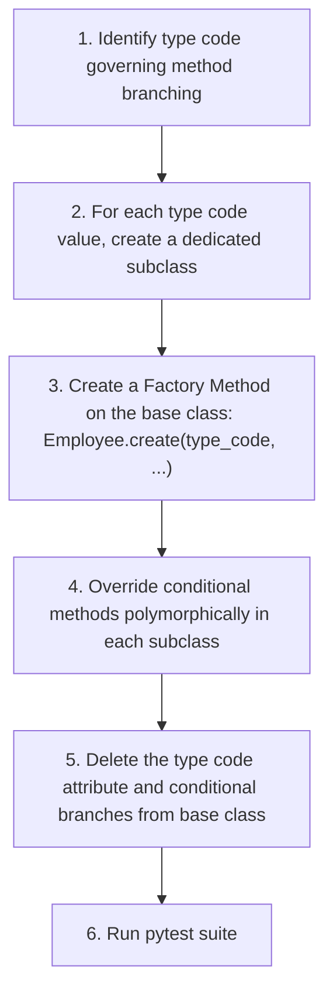

# Replace Type Code with Subclasses 🧬

## Source Reference
* **Book:** *Dive Into Refactoring* (Alexander Shvets), Chapter: *Refactoring Techniques / Organizing Data / Replace Type Code with Subclasses*
* **Design Pattern Bridge:** [Factory Method](../../../design-patterns/creational/factory-method.md)
* **Fixes Code Smells:** [Primitive Obsession](../../code-smells/bloaters/primitive-obsession.md), [Switch Statements](../../code-smells/oo-abusers/switch-statements.md)
* **Target Language:** Modern Python 3 (Python 3.10+) with `pytest`.

---

## 1. Intent and Motivation

You have a type code that **directly affects the behavior of the class's methods** (via `match/case` or `if/elif` branches), and the type of the object **does not change after instantiation**.

**Create a subclass for each value of the type code, and extract the type-specific behavior polymorphically into each subclass.**

Subclassing removes procedural conditionals and adheres to the Open-Closed Principle (OCP). Adding a new variant in the future simply requires creating a new subclass without editing existing code.

---

## 2. Step-by-Step Mechanics



1. **Create Subclasses:** Inherit from the host class for each type code.
2. **Factory Method:** Replace direct constructor calls with a factory method that instantiates the proper subclass based on the type code.
3. **Override Polymorphically:** Move the corresponding conditional branch body into each subclass's method override.
4. **Remove Branching:** Remove the conditional and type code attribute from the base class.
5. **Test:** Run tests.

---

## 3. Python Before & After Demonstration

### A. Smelly / Legacy Code (Type Code Driving Conditional Calculations)
```python
# employee_smelly.py
class Employee:
  ENGINEER = 0
  SALESMAN = 1
  MANAGER = 2

  def __init__(
      self,
      emp_type: int,
      base_salary: float,
      commission: float = 0.0,
      bonus: float = 0.0,
  ) -> None:
    self.type = emp_type
    self.base_salary = base_salary
    self.commission = commission
    self.bonus = bonus

  def calculate_pay(self) -> float:
    match self.type:
      case Employee.ENGINEER:
        return self.base_salary
      case Employee.SALESMAN:
        return self.base_salary + self.commission
      case Employee.MANAGER:
        return self.base_salary + self.bonus
      case _:
        raise ValueError(f"Unknown type: {self.type}")
```

### B. Pytest Baseline Contract
```python
# test_employee.py
from employee_smelly import Employee


def test_employee_pay():
  eng = Employee(Employee.ENGINEER, 5000.0)
  sales = Employee(Employee.SALESMAN, 3000.0, commission=1500.0)
  mgr = Employee(Employee.MANAGER, 8000.0, bonus=2000.0)

  assert eng.calculate_pay() == 5000.0
  assert sales.calculate_pay() == 4500.0
  assert mgr.calculate_pay() == 10000.0
```

### C. Refactored Clean Code (Polymorphic Subclasses + Factory Method)
```python
# employee_clean.py
from abc import ABC, abstractmethod


class Employee(ABC):
  """Abstract Base Class with clean polymorphic interface."""

  def __init__(self, base_salary: float) -> None:
    self.base_salary = base_salary

  @abstractmethod
  def calculate_pay(self) -> float:
    ...

  @classmethod
  def create(
      cls,
      emp_type: str,
      base_salary: float,
      commission: float = 0.0,
      bonus: float = 0.0,
  ) -> "Employee":
    """Factory Method encapsulating creation mechanics."""
    match emp_type.upper():
      case "ENGINEER":
        return Engineer(base_salary)
      case "SALESMAN":
        return Salesman(base_salary, commission)
      case "MANAGER":
        return Manager(base_salary, bonus)
      case _:
        raise ValueError(f"Unknown employee type: {emp_type}")


class Engineer(Employee):

  def calculate_pay(self) -> float:
    return self.base_salary


class Salesman(Employee):

  def __init__(self, base_salary: float, commission: float) -> None:
    super().__init__(base_salary)
    self.commission = commission

  def calculate_pay(self) -> float:
    return self.base_salary + self.commission


class Manager(Employee):

  def __init__(self, base_salary: float, bonus: float) -> None:
    super().__init__(base_salary)
    self.bonus = bonus

  def calculate_pay(self) -> float:
    return self.base_salary + self.bonus
```

---

## 4. Complexity, Trade-offs & Anti-patterns

* **When NOT to Subclass:** If an object's type **changes during its lifetime** (e.g., an `Engineer` is promoted to `Manager` at runtime), subclassing will not work because an object cannot change its class in Python cleanly. In that case, use [Replace Type Code with State/Strategy](replace-type-code-with-state-strategy.md).

---

## 5. Related Techniques & Design Patterns

* **Alternative (Runtime Changes):** [Replace Type Code with State/Strategy](replace-type-code-with-state-strategy.md).
* **Companion Pattern:** [Factory Method](../../../design-patterns/creational/factory-method.md).
