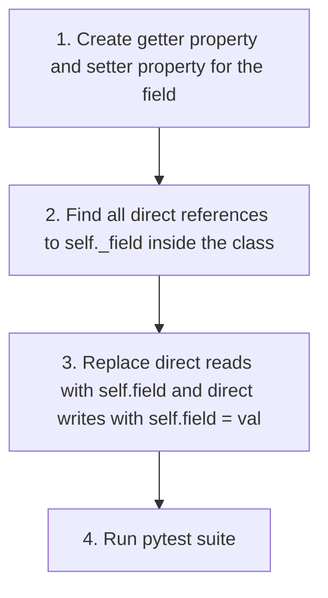

# Self Encapsulate Field 🛡️

## Source Reference
* **Book:** *Dive Into Refactoring* (Alexander Shvets), Chapter: *Refactoring Techniques / Organizing Data / Self Encapsulate Field*
* **Target Language:** Modern Python 3 (Python 3.10+) with `pytest`.

---

## 1. Intent and Motivation

You are accessing private fields directly within a class: `self._low = 0; self._high = 100`. **Create a getter and setter for the field, and use only these accessors to access the field, even within the class itself.**

Self-encapsulation is controversial: direct field access is simpler, but indirect access (via `@property`) allows subclasses to override how the value is calculated or allows lazy initialization without modifying every method that reads the field.

---

## 2. Step-by-Step Mechanics



1. **Create Accessors:** Define `@property` and `@prop.setter` on the class.
2. **Replace Internal References:** Search the class body and change `self._field` to `self.field`.
3. **Test:** Run tests.
4. **Override in Subclasses:** Subclasses can now override the property to provide dynamic or computed values.

---

## 3. Python Before & After Demonstration

### A. Smelly / Legacy Code (Direct Field Access Obstructing Lazy Loading)
```python
# range_smelly.py
class IntRange:

  def __init__(self, low: int, high: int) -> None:
    self._low = low
    self._high = high

  def includes(self, arg: int) -> bool:
    # Direct field access makes it difficult for subclasses to modify bounds dynamically
    return self._low <= arg <= self._high
```

### B. Pytest Baseline Contract
```python
# test_range.py
from range_smelly import IntRange


def test_range_includes():
  r = IntRange(10, 20)
  assert r.includes(15) is True
  assert r.includes(5) is False
```

### C. Refactored Clean Code (Self Encapsulated Properties)
```python
# range_clean.py
class IntRange:
  """Clean class: internal methods access fields strictly via properties."""

  def __init__(self, low: int, high: int) -> None:
    self._low = low
    self._high = high

  @property
  def low(self) -> int:
    return self._low

  @property
  def high(self) -> int:
    return self._high

  def includes(self, arg: int) -> bool:
    return self.low <= arg <= self.high


class DynamicCappedRange(IntRange):
  """Subclass can now effortlessly alter 'high' without touching includes()!"""

  @property
  def high(self) -> int:
    # Dynamically capped by system environment or setting:
    return min(self._high, 100)
```

---

## 4. Complexity, Trade-offs & Anti-patterns

* **Pragmatic Python Practice:** In standard Python, direct attribute access (`self.low`) is preferred until you actually need custom getter/setter logic or subclass overriding. Do not prematurely self-encapsulate every trivial field unless an architectural requirement calls for it.

---

## 5. Related Techniques & Design Patterns

* **Companion:** [Encapsulate Field](encapsulate-field.md).
