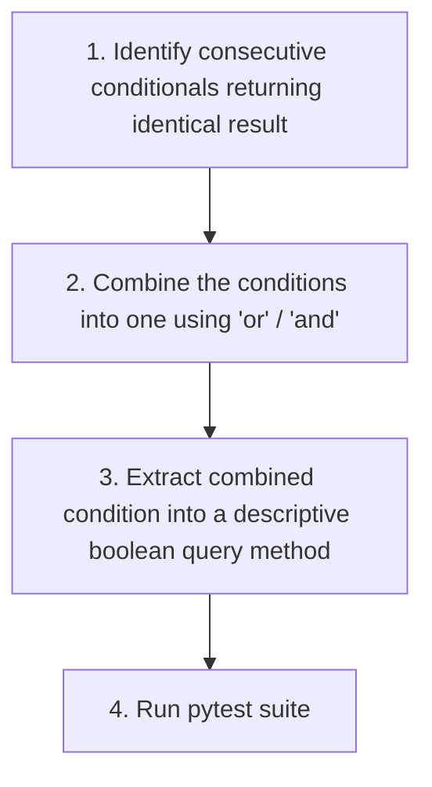

# Consolidate Conditional Expression 🔗

## Source Reference
* **Book:** *Dive Into Refactoring* (Alexander Shvets), Chapter: *Refactoring Techniques / Simplifying Conditional Expressions / Consolidate Conditional Expression*
* **Fixes Code Smells:** [Duplicate Code](../../code-smells/dispensables/duplicate-code.md), [Long Method](../../code-smells/bloaters/long-method.md)
* **Target Language:** Modern Python 3 (Python 3.10+) with `pytest`.

---

## 1. Intent and Motivation

You have a series of conditional tests where **different checks lead to the exact same outcome or return value**.

**Consolidate them into a single conditional expression using `or` / `and` operators, and extract the unified expression into a self-documenting method.**

Having 4 separate `if` statements that all return `0.0` makes the code look like 4 independent, unrelated special cases. Consolidating them signals to the reader that all 4 conditions belong to a single cohesive business rule (e.g., "ineligibility for disability benefit").

---

## 2. Step-by-Step Mechanics



1. **Verify Identical Actions:** Ensure each branch produces the exact same result with zero divergent side-effects.
2. **Combine with Logical Operators:** Merge the conditions using `or` (or `and` for nested clauses).
3. **Extract Query Method:** Extract the combined expression into a clean method (e.g., `is_ineligible_for_disability()`).
4. **Test:** Run tests.

---

## 3. Python Before & After Demonstration

### A. Smelly / Legacy Code (Scattered Independent Checks Returning Zero)
```python
# disability_smelly.py
class Employee:

  def __init__(
      self,
      seniority_years: int,
      months_disabled: int,
      is_part_time: bool,
  ) -> None:
    self.seniority_years = seniority_years
    self.months_disabled = months_disabled
    self.is_part_time = is_part_time

  def calculate_disability_amount(self) -> float:
    # 3 separate checks returning the exact same 0.0 value:
    if self.seniority_years < 2:
      return 0.0
    if self.months_disabled > 12:
      return 0.0
    if self.is_part_time:
      return 0.0

    # Main disability calculation:
    return 1000.0 + (self.seniority_years * 100.0)
```

### B. Pytest Baseline Contract
```python
# test_disability.py
from disability_smelly import Employee


def test_disability_calculations():
  junior = Employee(seniority_years=1, months_disabled=2, is_part_time=False)
  long_disabled = Employee(
      seniority_years=5, months_disabled=14, is_part_time=False
  )
  qualified = Employee(
      seniority_years=5, months_disabled=3, is_part_time=False
  )

  assert junior.calculate_disability_amount() == 0.0
  assert long_disabled.calculate_disability_amount() == 0.0
  assert qualified.calculate_disability_amount() == 1500.0
```

### C. Refactored Clean Code (Consolidated Expression with Query Method)
```python
# disability_clean.py
class Employee:
  """Clean class: Consolidated ineligibility rule."""

  def __init__(
      self,
      seniority_years: int,
      months_disabled: int,
      is_part_time: bool,
  ) -> None:
    self.seniority_years = seniority_years
    self.months_disabled = months_disabled
    self.is_part_time = is_part_time

  @property
  def is_ineligible_for_disability(self) -> bool:
    """Consolidated business rule unifying ineligibility conditions."""
    return (
        self.seniority_years < 2
        or self.months_disabled > 12
        or self.is_part_time
    )

  def calculate_disability_amount(self) -> float:
    if self.is_ineligible_for_disability:
      return 0.0
    return 1000.0 + (self.seniority_years * 100.0)
```

---

## 4. Complexity, Trade-offs & Anti-patterns

* **When NOT to Consolidate:** If the checks are truly unrelated and coincidental (e.g., one check verifies network connectivity, while another checks user authentication), keep them separate to communicate independent failure reasons.

---

## 5. Related Techniques & Design Patterns

* **Companion:** [Decompose Conditional](decompose-conditional.md), [Extract Method](../composing-methods/extract-method.md).
