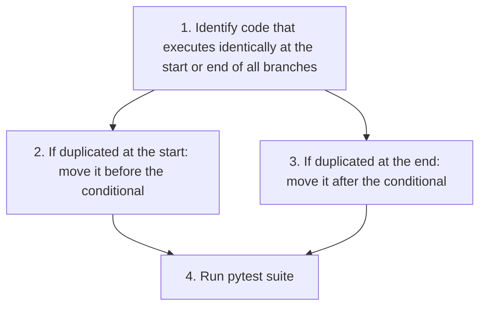

# Consolidate Duplicate Conditional Fragments 🧹

## Source Reference
* **Book:** *Dive Into Refactoring* (Alexander Shvets), Chapter: *Refactoring Techniques / Simplifying Conditional Expressions / Consolidate Duplicate Conditional Fragments*
* **Fixes Code Smells:** [Duplicate Code](../../code-smells/dispensables/duplicate-code.md)
* **Target Language:** Modern Python 3 (Python 3.10+) with `pytest`.

---

## 1. Intent and Motivation

Identical fragments of code appear **in all branches of a conditional statement** (either at the start or at the end of each branch).

**Move the duplicated code outside of the conditional statement.**

When a statement is executed regardless of which branch is taken, keeping it duplicated inside every branch creates cognitive noise and risks someone updating one branch while forgetting another.

---

## 2. Step-by-Step Mechanics



1. **Verify Identical Execution:** Check that the code block performs the exact same operation in every branch.
2. **Move Outside:**
   - If duplicated at the start of branches, hoist it before the `if`.
   - If duplicated at the end of branches, hoist it after the `if/else`.
3. **Test:** Run tests.

---

## 3. Python Before & After Demonstration

### A. Smelly / Legacy Code (Duplicated `send_order()` and `log()` in Both Branches)
```python
# order_smelly.py
def process_order(is_special_deal: bool, price: float) -> float:
  if is_special_deal:
    total = price * 0.80
    send_confirmation_email()  # Duplicated!
    log_transaction(total)  # Duplicated!
    return total
  else:
    total = price * 0.95
    send_confirmation_email()  # Duplicated!
    log_transaction(total)  # Duplicated!
    return total


def send_confirmation_email():
  pass


def log_transaction(total: float):
  pass
```

### B. Pytest Baseline Contract
```python
# test_order.py
from order_smelly import process_order


def test_process_order_discount():
  assert process_order(is_special_deal=True, price=100.0) == 80.0
  assert process_order(is_special_deal=False, price=100.0) == 95.0
```

### C. Refactored Clean Code (Duplication Hoisted Outside Conditional)
```python
# order_clean.py
def process_order(is_special_deal: bool, price: float) -> float:
  # The conditional focuses STRICTLY on what varies:
  discount = 0.80 if is_special_deal else 0.95
  total = price * discount

  # Universal post-processing executed once cleanly:
  send_confirmation_email()
  log_transaction(total)

  return total


def send_confirmation_email():
  pass


def log_transaction(total: float):
  pass
```

---

## 4. Complexity, Trade-offs & Anti-patterns

* **Exception Handling Blocks:** The same rule applies to `try/except/finally`. If a cleanup step is duplicated inside both the `try` and `except` blocks, move it to `finally:`!

---

## 5. Related Techniques & Design Patterns

* **Companion:** [Extract Method](../composing-methods/extract-method.md).
