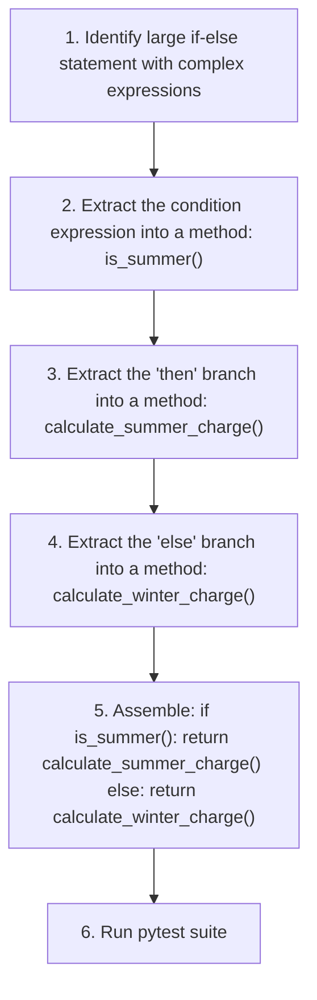

# Decompose Conditional 🧩

## Source Reference
* **Book:** *Dive Into Refactoring* (Alexander Shvets), Chapter: *Refactoring Techniques / Simplifying Conditional Expressions / Decompose Conditional*
* **Fixes Code Smells:** [Long Method](../../code-smells/bloaters/long-method.md), [Comments](../../code-smells/dispensables/comments.md)
* **Target Language:** Modern Python 3 (Python 3.10+) with `pytest`.

---

## 1. Intent and Motivation

You have a complex conditional (`if-else` statement) where **both the condition expression and the bodies of the branches are large, tangled, and difficult to comprehend at a glance**.

**Decompose the conditional by extracting the condition into a dedicated boolean query method, and extracting the then-branch and else-branch into their own descriptive methods.**

Conditionals often mix high-level business decisions ("Is it summer season?") with low-level arithmetic (date boundary checking, surcharge algorithms). Decomposing the conditional separates the decision from the implementation details.

---

## 2. Step-by-Step Mechanics



1. **Extract Condition:** Extract the boolean test into a method returning a boolean: `self._is_summer(date)`.
2. **Extract Then-Branch:** Extract the `then` clause into a method: `self._summer_charge(quantity)`.
3. **Extract Else-Branch:** Extract the `else` clause into a method: `self._winter_charge(quantity)`.
4. **Test:** Run tests.

---

## 3. Python Before & After Demonstration

### A. Smelly / Legacy Code (Monolithic Seasonal Billing Method)
```python
# billing_smelly.py
import datetime


class HeatingService:

  def __init__(self, summer_rate: float, winter_rate: float) -> None:
    self.summer_rate = summer_rate
    self.winter_rate = winter_rate
    self.winter_service_charge = 50.0

  def calculate_bill(
      self, date: datetime.date, consumption_units: float
  ) -> float:
    # Smelly: Mixed date boundary checking and divergent rate math inside 1 block
    if (
        date < datetime.date(date.year, 6, 1)
        or date > datetime.date(date.year, 8, 31)
    ):
      return (
          consumption_units * self.winter_rate + self.winter_service_charge
      )
    else:
      return consumption_units * self.summer_rate
```

### B. Pytest Baseline Contract
```python
# test_billing.py
import datetime
from billing_smelly import HeatingService


def test_heating_billing():
  service = HeatingService(summer_rate=1.0, winter_rate=2.0)
  summer_date = datetime.date(2026, 7, 15)
  winter_date = datetime.date(2026, 1, 15)

  assert service.calculate_bill(summer_date, 100) == 100.0  # 100 * 1.0
  assert (
      service.calculate_bill(winter_date, 100) == 250.0
  )  # 100 * 2.0 + 50
```

### C. Refactored Clean Code (Decomposed Conditional)
```python
# billing_clean.py
import datetime


class HeatingService:
  """Clean class: Decision logic reads like natural English."""

  def __init__(self, summer_rate: float, winter_rate: float) -> None:
    self.summer_rate = summer_rate
    self.winter_rate = winter_rate
    self.winter_service_charge = 50.0

  def calculate_bill(
      self, date: datetime.date, consumption_units: float
  ) -> float:
    if self._is_summer(date):
      return self._calculate_summer_charge(consumption_units)
    return self._calculate_winter_charge(consumption_units)

  def _is_summer(self, date: datetime.date) -> bool:
    summer_start = datetime.date(date.year, 6, 1)
    summer_end = datetime.date(date.year, 8, 31)
    return summer_start <= date <= summer_end

  def _calculate_summer_charge(self, units: float) -> float:
    return units * self.summer_rate

  def _calculate_winter_charge(self, units: float) -> float:
    return (units * self.winter_rate) + self.winter_service_charge
```

---

## 4. Complexity, Trade-offs & Anti-patterns

* **Avoid Over-Extracting Trivial Conditionals:** If an `if` statement is `if is_active: return total`, extracting `is_active` into a separate method is redundant. Decompose only when the condition or branches contain multi-step logic.

---

## 5. Related Techniques & Design Patterns

* **Companion:** [Extract Method](../composing-methods/extract-method.md), [Replace Nested Conditional with Guard Clauses](replace-nested-conditional-with-guard-clauses.md).
