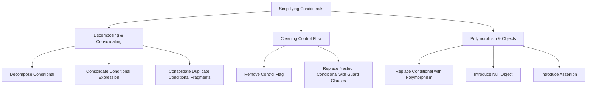

# Simplifying Conditional Expressions 🔀

## Source Reference
* **Book:** *Dive Into Refactoring* (Alexander Shvets), Chapter: *Refactoring Techniques / Simplifying Conditional Expressions*
* **Target Language:** Modern Python 3 (Python 3.10+) with `pytest`.

---

## Overview

Conditionals have a tendency to become bloated, deeply nested, and convoluted over time. Complex boolean expressions hide business logic, deep nesting creates "arrow anti-patterns", and massive `if-elif-else` branches create fragile coupling.

The techniques in this group unravel tangled branching logic, extract readable boolean predicates, replace nested ladders with early returns (guard clauses), and eliminate type-checking conditionals through polymorphism and Null Objects.

---

## The 8 Techniques in this Group

| Technique | Problem Solved | Core Transformation |
| :--- | :--- | :--- |
| [**Decompose Conditional**](decompose-conditional.md) | Complex `if-else` tree with long branch bodies | Extract condition and branch bodies into methods |
| [**Consolidate Conditional Expression**](consolidate-conditional-expression.md) | Multiple conditional checks lead to the exact same result | Combine checks with `or` / `and` into a single query method |
| [**Consolidate Duplicate Conditional Fragments**](consolidate-duplicate-conditional-fragments.md) | Identical code executed across all branches | Move the duplicated code outside the conditional |
| [**Remove Control Flag**](remove-control-flag.md) | Boolean variable used solely to control loop termination | Use `break`, `continue`, or `return` instead |
| [**Replace Nested Conditional with Guard Clauses**](replace-nested-conditional-with-guard-clauses.md) | Deeply nested `if` statements obscure main success path | Use early returns (`return` / `raise`) for edge cases |
| [**Replace Conditional with Polymorphism**](replace-conditional-with-polymorphism.md) | Condition checks object type to execute specific code | Move branches into polymorphic subclass methods |
| [**Introduce Null Object**](introduce-null-object.md) | Code littered with `if obj is None:` defensive checks | Return a Null Object that implements the same interface |
| [**Introduce Assertion**](introduce-assertion.md) | Code assumes certain state conditions without checking | Make assumptions explicit using assertions or contract checks |
