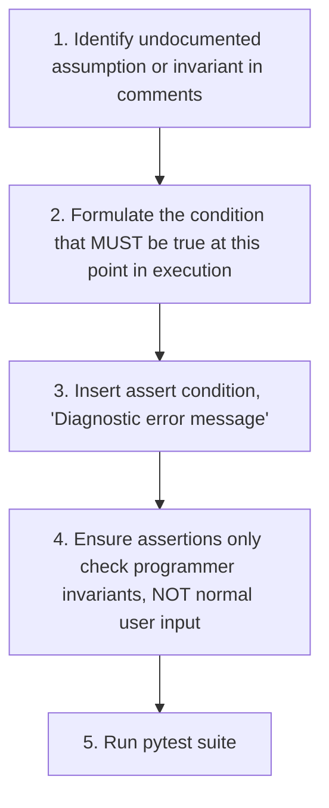

# Introduce Assertion 🚨

## Source Reference
* **Book:** *Dive Into Refactoring* (Alexander Shvets), Chapter: *Refactoring Techniques / Simplifying Conditional Expressions / Introduce Assertion*
* **Design Principle Bridge:** *Design by Contract (DbC)*, *Fail Fast Principle*
* **Fixes Code Smells:** [Comments](../../code-smells/dispensables/comments.md)
* **Target Language:** Modern Python 3 (Python 3.10+) with `pytest`.

---

## 1. Intent and Motivation

A section of code assumes that certain conditions or invariants **must always be true** for the algorithm to execute correctly. These assumptions are either undocumented or described only in comments.

**Make the assumptions explicit and executable by introducing assertions (`assert`) or contract validation checks.**

Assertions act as self-checking, executable documentation. When an assertion fails during development or testing, it catches bugs at the exact point of failure rather than allowing corrupted state to travel 5 layers down into another module before crashing.

---

## 2. Step-by-Step Mechanics



1. **Identify Preconditions:** Look for comments like `# expense_limit must always be positive here` or division where the divisor is assumed non-zero.
2. **Add Assertion:** Place an `assert condition, "Error explanation"` at the top of the section.
3. **Distinguish Input Validation vs Invariants:**
   - Use standard `if not valid: raise ValueError(...)` for checking external user/API input.
   - Use `assert` for internal programmer invariants and sanity checks.
4. **Test:** Run tests.

---

## 3. Python Before & After Demonstration

### A. Smelly / Legacy Code (Silent Assumptions Trapped in Comments)
```python
# project_smelly.py
class Project:

  def __init__(
      self, expense_limit: float | None = None, primary_project: "Project" = None
  ) -> None:
    self.expense_limit = expense_limit
    self.primary_project = primary_project

  def get_expense_limit(self) -> float:
    # Assumes either expense_limit is set OR primary_project exists.
    # If both are None, this will crash mysteriously with AttributeError later!
    if self.expense_limit is not None:
      return self.expense_limit
    return self.primary_project.get_expense_limit()
```

### B. Pytest Baseline Contract
```python
# test_project.py
import pytest
from project_smelly import Project


def test_valid_project():
  p = Project(expense_limit=500.0)
  assert p.get_expense_limit() == 500.0


def test_invalid_unconfigured_project_crashes_unclearly():
  broken = Project(expense_limit=None, primary_project=None)
  # Crashes with confusing AttributeError: 'NoneType' object has no attribute 'get_expense_limit'
  with pytest.raises(AttributeError):
    broken.get_expense_limit()
```

### C. Refactored Clean Code (Explicit Assertion / Invariant Check)
```python
# project_clean.py
class Project:
  """Clean class: Preconditions and invariants are explicitly validated."""

  def __init__(
      self,
      expense_limit: float | None = None,
      primary_project: "Project | None" = None,
  ) -> None:
    self.expense_limit = expense_limit
    self.primary_project = primary_project

  def get_expense_limit(self) -> float:
    # Introduce Assertion: Fail fast with crystal clear diagnostic guidance:
    assert self.expense_limit is not None or self.primary_project is not None, (
        "Invariant violated: Project must define its own expense_limit or"
        " delegate to a primary_project."
    )

    if self.expense_limit is not None:
      return self.expense_limit
    assert self.primary_project is not None
    return self.primary_project.get_expense_limit()
```

---

## 4. Complexity, Trade-offs & Anti-patterns

* **Python `-O` Optimization Flag Warning:** Remember that Python disables `assert` statements if run with the `-O` (optimize) flag. For critical business validation, security gates, or external user inputs, use explicit `if not condition: raise ValueError(...)`. Use `assert` strictly for internal structural invariants.

---

## 5. Related Techniques & Design Patterns

* **Companion:** [Replace Nested Conditional with Guard Clauses](replace-nested-conditional-with-guard-clauses.md).
