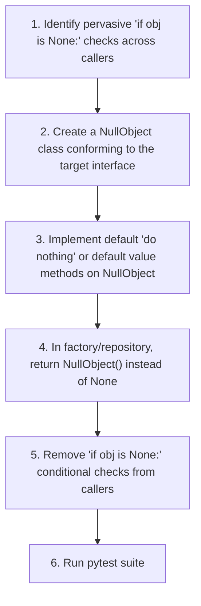

# Introduce Null Object 👻

## Source Reference
* **Book:** *Dive Into Refactoring* (Alexander Shvets), Chapter: *Refactoring Techniques / Simplifying Conditional Expressions / Introduce Null Object*
* **Design Pattern Bridge:** Null Object Pattern
* **Fixes Code Smells:** [Temporary Field](../../code-smells/oo-abusers/temporary-field.md)
* **Target Language:** Modern Python 3 (Python 3.10+) with `pytest`.

---

## 1. Intent and Motivation

Methods or database queries return `None` when an object is missing, forcing calling code across the entire application to be littered with **defensive boilerplate: `if customer is not None: ... else: ...`**.

**Instead of returning `None`, return a Null Object that implements the exact same interface/Protocol as the real object, providing default harmless behavior (empty strings, zero calculations, or no-op actions).**

Null Objects eliminate defensive `None`-checking conditionals and eradicate dreaded `AttributeError: 'NoneType' object has no attribute 'x'` crashes.

---

## 2. Step-by-Step Mechanics



1. **Create Null Class:** Build a class implementing the collaborator's methods (e.g., `NullCustomer`).
2. **Harmless Defaults:** In the null class, return safe defaults (e.g., `"occupant"` for name, `NullPlan()` for subscription plan).
3. **Return from Source:** When a search returns no result, return `NullCustomer()` instead of `None`.
4. **Strip Checks:** Delete `if customer is not None:` checks at call sites and treat the object uniformly.
5. **Test:** Run tests.

---

## 3. Python Before & After Demonstration

### A. Smelly / Legacy Code (Pervasive `None`-Checking Boilerplate)
```python
# site_smelly.py
class Customer:

  def __init__(self, name: str, plan_rate: float) -> None:
    self.name = name
    self.plan_rate = plan_rate


class Site:

  def __init__(self, customer: Customer | None = None) -> None:
    self.customer = customer


def render_customer_billing(site: Site) -> dict:
  # Smelly: Defensive None checks repeated at every call site!
  if site.customer is None:
    customer_name = "occupant"
    charge = 0.0
  else:
    customer_name = site.customer.name
    charge = site.customer.plan_rate * 1.05

  return {"name": customer_name, "charge": charge}
```

### B. Pytest Baseline Contract
```python
# test_site.py
from site_smelly import Customer, Site, render_customer_billing


def test_customer_billing():
  real_site = Site(Customer("Alice", 100.0))
  assert render_customer_billing(real_site) == {
      "name": "Alice",
      "charge": 105.0,
  }

  empty_site = Site(None)
  assert render_customer_billing(empty_site) == {
      "name": "occupant",
      "charge": 0.0,
  }
```

### C. Refactored Clean Code (Null Object Pattern)
```python
# site_clean.py
from typing import Protocol


class CustomerProtocol(Protocol):

  @property
  def name(self) -> str:
    ...

  @property
  def plan_rate(self) -> float:
    ...


class RealCustomer:

  def __init__(self, name: str, plan_rate: float) -> None:
    self._name = name
    self._plan_rate = plan_rate

  @property
  def name(self) -> str:
    return self._name

  @property
  def plan_rate(self) -> float:
    return self._plan_rate


class NullCustomer:
  """Null Object: encapsulates safe, default behaviors for missing customers."""

  @property
  def name(self) -> str:
    return "occupant"

  @property
  def plan_rate(self) -> float:
    return 0.0


class Site:

  def __init__(self, customer: CustomerProtocol | None = None) -> None:
    # Guaranteed to never be None:
    self.customer: CustomerProtocol = customer or NullCustomer()


def render_customer_billing(site: Site) -> dict:
  # Zero defensive None checks! Completely uniform invocation:
  charge = site.customer.plan_rate * 1.05
  return {"name": site.customer.name, "charge": charge}
```

---

## 4. Complexity, Trade-offs & Anti-patterns

* **When NOT to Use:** If the caller genuinely needs to take a radically different action when data is absent (e.g., throwing a `404 Not Found` HTTP exception or redirecting to a login page), returning a Null Object will mask errors. Use Null Objects when the absent object can be treated as a harmless no-op.

---

## 5. Related Techniques & Design Patterns

* **Companion Pattern:** Null Object Pattern, [Strategy Pattern](../../../design-patterns/behavioral/strategy.md).
