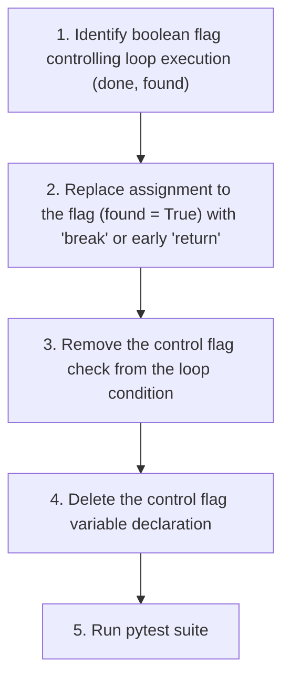

# Remove Control Flag 🚩

## Source Reference
* **Book:** *Dive Into Refactoring* (Alexander Shvets), Chapter: *Refactoring Techniques / Simplifying Conditional Expressions / Remove Control Flag*
* **Target Language:** Modern Python 3 (Python 3.10+) with `pytest`.

---

## 1. Intent and Motivation

You have a boolean variable that acts as a **control flag** for a loop or algorithm (`found = False`, `done = False`, `flag = True`). The variable is checked on every iteration, leading to unnatural loop conditions and cluttered branching.

**Use `break`, `continue`, or an early `return` to terminate the loop directly instead of managing a manual control flag.**

Control flags are a holdover from outdated structured programming dogma that demanded "one entry point and one exit point" for every function. In modern programming, early `return` or `break` is far cleaner, eliminates flag-checking variables, and avoids unnecessary loop cycles.

---

## 2. Step-by-Step Mechanics



1. **Find Flag Triggers:** Locate where the flag value is changed inside the loop.
2. **Replace with Jump:**
   - If the method has finished its work: replace with an immediate `return result`.
   - If work remains after the loop: replace with `break`.
3. **Clean Up:** Remove the flag from the loop condition and delete the flag variable.
4. **Test:** Verify with `pytest`.

---

## 3. Python Before & After Demonstration

### A. Smelly / Legacy Code (Manual `found` Flag Driving Loop Execution)
```python
# security_smelly.py
def check_security(people: list[str]) -> str:
  # Smelly: Control flag 'found' used to exit loop
  found = False
  alert_target = ""

  for person in people:
    if not found:
      if person in ("Don", "John"):
        alert_target = person
        found = True

  if found:
    return f"ALERT: {alert_target}"
  return "SAFE"
```

### B. Pytest Baseline Contract
```python
# test_security.py
from security_smelly import check_security


def test_security_check():
  assert check_security(["Alice", "Don", "Bob"]) == "ALERT: Don"
  assert check_security(["Alice", "Bob"]) == "SAFE"
```

### C. Refactored Clean Code (Early Return)
```python
# security_clean.py
def check_security(people: list[str]) -> str:
  """Clean, declarative function with immediate early returns."""
  suspects = {"Don", "John"}

  for person in people:
    if person in suspects:
      return f"ALERT: {person}"

  return "SAFE"
```

---

## 4. Complexity, Trade-offs & Anti-patterns

* **Python's `for...else` Construct:** In Python, a loop can have an `else:` block that executes only if the loop was *not* broken by a `break`. This can be used for search patterns:
  ```python
  for item in items:
    if condition(item):
      return item
  return default_value
```

---

## 5. Related Techniques & Design Patterns

* **Companion:** [Replace Nested Conditional with Guard Clauses](replace-nested-conditional-with-guard-clauses.md).
