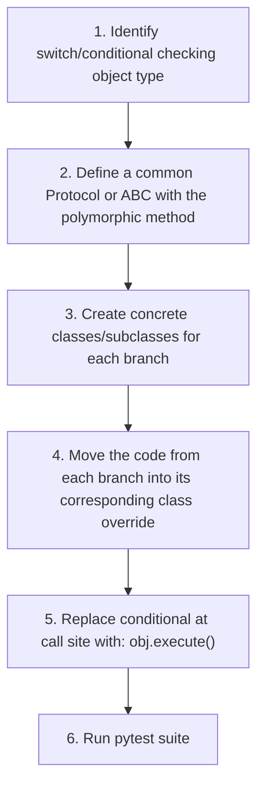

# Replace Conditional with Polymorphism 🦄

## Source Reference
* **Book:** *Dive Into Refactoring* (Alexander Shvets), Chapter: *Refactoring Techniques / Simplifying Conditional Expressions / Replace Conditional with Polymorphism*
* **Design Pattern Bridge:** [Strategy Pattern](../../../design-patterns/behavioral/strategy.md), [State Pattern](../../../design-patterns/behavioral/state.md), [Factory Method](../../../design-patterns/creational/factory-method.md)
* **Fixes Code Smells:** [Switch Statements](../../code-smells/oo-abusers/switch-statements.md)
* **Target Language:** Modern Python 3 (Python 3.10+) with `pytest`.

---

## 1. Intent and Motivation

You have a conditional (`if-elif-else` ladder or Python `match/case` statement) that **performs different actions depending on the object's type, status code, or variant**.

**Move each branch of the conditional into an overridden method of a common subclass hierarchy or Strategy Protocol. Replace the conditional with a single polymorphic method call.**

Procedural conditionals that switch on object types violate the Open-Closed Principle (OCP). Adding a new variant requires hunting down every switch statement in the application. Polymorphism allows the object itself to decide how to execute the behavior.

---

## 2. Step-by-Step Mechanics



1. **Define Protocol / ABC:** Declare the shared polymorphic method interface.
2. **Implement Subclasses / Strategies:** For each conditional branch, implement the method on the corresponding class.
3. **Move Branch Code:** Relocate the specific calculations into their respective class implementations.
4. **Call Polymorphically:** Replace the big `if/elif` block with `obj.calculate()`.
5. **Test:** Run tests.

---

## 3. Python Before & After Demonstration

### A. Smelly / Legacy Code (Type-Checking Conditional for Bird Speed)
```python
# bird_smelly.py
class Bird:

  def __init__(
      self,
      bird_type: str,
      voltage: float = 0.0,
      coconuts: int = 0,
      is_nailed: bool = False,
  ) -> None:
    self.type = bird_type
    self.voltage = voltage
    self.coconuts = coconuts
    self.is_nailed = is_nailed

  def get_speed(self) -> float:
    match self.type:
      case "EUROPEAN":
        return 40.0
      case "AFRICAN":
        return max(0.0, 40.0 - 2.0 * self.coconuts)
      case "NORWEGIAN_BLUE":
        return 0.0 if self.is_nailed else 24.0 * self.voltage
      case _:
        raise ValueError(f"Unknown bird: {self.type}")
```

### B. Pytest Baseline Contract
```python
# test_bird.py
from bird_smelly import Bird


def test_bird_speeds():
  assert Bird("EUROPEAN").get_speed() == 40.0
  assert Bird("AFRICAN", coconuts=2).get_speed() == 36.0
  assert (
      Bird("NORWEGIAN_BLUE", voltage=2.0, is_nailed=False).get_speed() == 48.0
  )
  assert (
      Bird("NORWEGIAN_BLUE", voltage=2.0, is_nailed=True).get_speed() == 0.0
  )
```

### C. Refactored Clean Code (Polymorphic Class Hierarchy)
```python
# bird_clean.py
from abc import ABC, abstractmethod


class Bird(ABC):
  """Polymorphic base class."""

  @abstractmethod
  def get_speed(self) -> float:
    ...


class EuropeanSwallow(Bird):

  def get_speed(self) -> float:
    return 40.0


class AfricanSwallow(Bird):

  def __init__(self, coconuts: int) -> None:
    self.coconuts = coconuts

  def get_speed(self) -> float:
    return max(0.0, 40.0 - 2.0 * self.coconuts)


class NorwegianBlueParrot(Bird):

  def __init__(self, voltage: float, is_nailed: bool) -> None:
    self.voltage = voltage
    self.is_nailed = is_nailed

  def get_speed(self) -> float:
    return 0.0 if self.is_nailed else 24.0 * self.voltage
```

---

## 4. Complexity, Trade-offs & Anti-patterns

* **When NOT to Use:** If the conditional only has 2 simple branches that will never grow (e.g., `if is_admin: return True else: return False`), creating 2 subclasses is unnecessary over-engineering. Reserve this technique for multi-branch conditionals that vary across multiple methods.

---

## 5. Related Techniques & Design Patterns

* **Companion Patterns:** [Strategy Pattern](../../../design-patterns/behavioral/strategy.md), [Factory Method](../../../design-patterns/creational/factory-method.md).
* **Fixes:** [Switch Statements](../../code-smells/oo-abusers/switch-statements.md).
