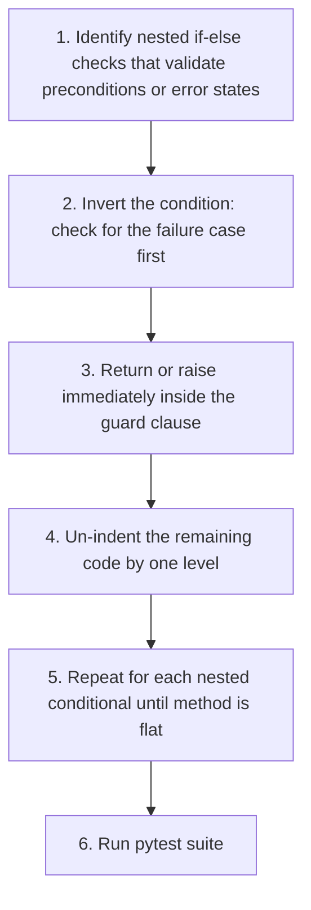

# Replace Nested Conditional with Guard Clauses 🛡️

## Source Reference
* **Book:** *Dive Into Refactoring* (Alexander Shvets), Chapter: *Refactoring Techniques / Simplifying Conditional Expressions / Replace Nested Conditional with Guard Clauses*
* **Design Principle Bridge:** *Fail Fast Principle*, *Bouncer Pattern*
* **Target Language:** Modern Python 3 (Python 3.10+) with `pytest`.

---

## 1. Intent and Motivation

You have a method with **deeply nested conditionals (the "Arrow Anti-pattern" or "Pyramid of Doom")** that make it hard to see what the normal, happy-path flow of execution is.

**Use guard clauses for all the special cases and error conditions: exit immediately with an early `return` or `raise`.**

Nested `if-else` blocks force the reader to keep multiple levels of indentation in their head simultaneously. Guard clauses act like bouncers at a club door: if you don't meet the entry criteria, you are rejected immediately, leaving the main body completely flat and un-indented.

---

## 2. Step-by-Step Mechanics



1. **Identify Edge Cases:** Find checks that represent error states, dead conditions, or special exemptions.
2. **Invert & Return:** Instead of checking `if is_valid: (20 lines)`, check `if not is_valid: return error`.
3. **Flatten:** Strip away the corresponding `else:` block and un-indent the remaining code.
4. **Test:** Run tests.

---

## 3. Python Before & After Demonstration

### A. Smelly / Legacy Code (The Pyramid of Doom)
```python
# payout_smelly.py
class PayrollService:

  def get_adjusted_payment(
      self, is_dead: bool, is_separated: bool, is_retired: bool, base_pay: float
  ) -> float:
    # Smelly: Deeply nested pyramid of doom
    result = 0.0
    if not is_dead:
      if not is_separated:
        if not is_retired:
          result = base_pay * 1.10
        else:
          result = base_pay * 0.80
      else:
        result = 0.0
    else:
      result = 5000.0  # Death benefit
    return result
```

### B. Pytest Baseline Contract
```python
# test_payout.py
from payout_smelly import PayrollService


def test_payment_adjustments():
  service = PayrollService()
  assert service.get_adjusted_payment(True, False, False, 1000) == 5000.0
  assert service.get_adjusted_payment(False, True, False, 1000) == 0.0
  assert service.get_adjusted_payment(False, False, True, 1000) == 800.0
  assert service.get_adjusted_payment(False, False, False, 1000) == 1100.0
```

### C. Refactored Clean Code (Flat Guard Clauses)
```python
# payout_clean.py
class PayrollService:
  """Clean class: Guard clauses handle special cases upfront; happy path is flat."""

  def get_adjusted_payment(
      self, is_dead: bool, is_separated: bool, is_retired: bool, base_pay: float
  ) -> float:
    # 1. Guard clauses handle special cases immediately:
    if is_dead:
      return 5000.0
    if is_separated:
      return 0.0
    if is_retired:
      return base_pay * 0.80

    # 2. Main happy-path execution is flat and unindented:
    return base_pay * 1.10
```

---

## 4. Complexity, Trade-offs & Anti-patterns

* **Guard Clause vs True Two-Way Branch:**
  - If both branches represent equally normal, valid paths (e.g., `if payment_type == "CARD": ... else: ...`), a standard `if/else` or polymorphism is appropriate.
  - Guard clauses are specifically for **asymmetric** conditions: filtering out invalid, exceptional, or terminal states.

---

## 5. Related Techniques & Design Patterns

* **Companion:** [Remove Control Flag](remove-control-flag.md), [Decompose Conditional](decompose-conditional.md).
