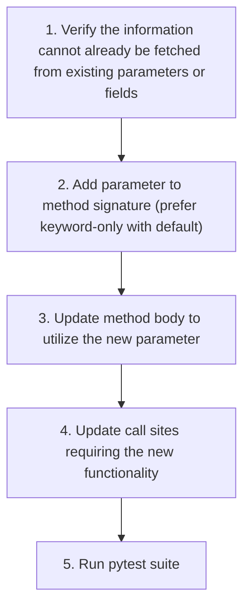

# Add Parameter ➕

## Source Reference
* **Book:** *Dive Into Refactoring* (Alexander Shvets), Chapter: *Refactoring Techniques / Simplifying Method Calls / Add Parameter*
* **Target Language:** Modern Python 3 (Python 3.10+) with `pytest`.

---

## 1. Intent and Motivation

A method **needs additional information from its caller** to fulfill a new requirement or calculation. **Add a parameter to the method signature.**

In Python, adding a parameter should be done carefully to avoid breaking existing callers. Using optional keyword arguments (`*, new_param: float = 0.0`) ensures backward compatibility while accommodating the new requirement.

---

## 2. Step-by-Step Mechanics



1. **Verify Necessity:** Check if the method can already obtain this data from existing parameters (e.g., via [Replace Parameter with Method Call](replace-parameter-with-method-call.md)) or instance fields.
2. **Add with Default:** In Python, add the parameter as an optional keyword argument with a sensible default: `def calculate(amount: float, *, tax_rate: float = 0.0):`.
3. **Update Call Sites:** Pass the new argument where required.
4. **Test:** Run tests.

---

## 3. Python Before & After Demonstration

### A. Smelly / Legacy Code (Method Lacking Necessary Context)
```python
# invoice_smelly.py
class InvoiceService:

  def compute_total(self, subtotal: float) -> float:
    # Cannot handle currency exchange or localized sales taxes!
    return subtotal
```

### B. Pytest Baseline Contract
```python
# test_invoice.py
from invoice_smelly import InvoiceService


def test_invoice_total():
  assert InvoiceService().compute_total(100.0) == 100.0
```

### C. Refactored Clean Code (Keyword-Only Parameter with Default)
```python
# invoice_clean.py
class InvoiceService:
  """Clean service: Extended with keyword-only parameter without breaking existing callers."""

  def compute_total(
      self, subtotal: float, *, tax_rate: float = 0.0
  ) -> float:
    return round(subtotal * (1.0 + tax_rate), 2)
```

---

## 4. Complexity, Trade-offs & Anti-patterns

* **Long Parameter List Smells:** If you find yourself adding a 4th or 5th parameter, stop! You are triggering the [Long Parameter List](../../code-smells/bloaters/long-parameter-list.md) smell. Use [Introduce Parameter Object](introduce-parameter-object.md) or [Preserve Whole Object](preserve-whole-object.md) instead.

---

## 5. Related Techniques & Design Patterns

* **Opposite:** [Remove Parameter](remove-parameter.md).
* **Next Steps (if parameters grow):** [Introduce Parameter Object](introduce-parameter-object.md).
