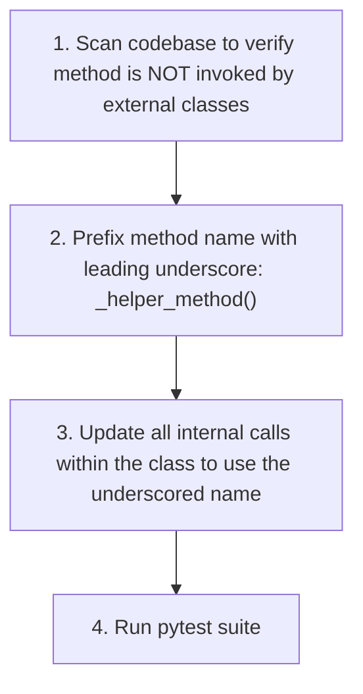

# Hide Method 🙈

## Source Reference
* **Book:** *Dive Into Refactoring* (Alexander Shvets), Chapter: *Refactoring Techniques / Simplifying Method Calls / Hide Method*
* **Design Principle Bridge:** *Information Hiding*, *Encapsulation*
* **Target Language:** Modern Python 3 (Python 3.10+) with `pytest`.

---

## 1. Intent and Motivation

A method is defined with **public visibility, but it is not called or needed by any external class**—it is used exclusively as an internal helper within its own class.

**Make the method private (prefix with a leading underscore `_` in Python) to reduce the class's public API surface.**

Every public method on a class represents a contract that you must support and avoid breaking. Exposing internal helpers bloats autocompletion in IDEs, confuses consumers of your class, and prevents you from refactoring internal algorithms safely.

---

## 2. Step-by-Step Mechanics



1. **Verify Visibility:** Check that no other classes outside this file/module call the method.
2. **Rename to Private:** Prefix the method name with `_` (e.g., `_calculate_tax()`).
3. **Update Internal References:** Change `self.calculate_tax()` to `self._calculate_tax()`.
4. **Test:** Run tests.

---

## 3. Python Before & After Demonstration

### A. Smelly / Legacy Code (Internal Parsing Helper Accidentally Exposed Publicly)
```python
# parser_smelly.py
class CsvReportProcessor:

  def process(self, raw_csv: str) -> list[dict]:
    lines = self.split_lines(raw_csv)
    return [self.parse_row(line) for line in lines]

  # Accidentally exposed internal helpers:
  def split_lines(self, raw_csv: str) -> list[str]:
    return [line.strip() for line in raw_csv.splitlines() if line.strip()]

  def parse_row(self, line: str) -> dict:
    parts = line.split(",")
    return {"id": parts[0], "val": parts[1]}
```

### B. Pytest Baseline Contract
```python
# test_parser.py
from parser_smelly import CsvReportProcessor


def test_processing():
  processor = CsvReportProcessor()
  res = processor.process("A,10\nB,20")
  assert len(res) == 2
```

### C. Refactored Clean Code (Private Internal Helpers)
```python
# parser_clean.py
class CsvReportProcessor:
  """Clean class: Public API consists ONLY of the cohesive process() entry point."""

  def process(self, raw_csv: str) -> list[dict]:
    lines = self._split_lines(raw_csv)
    return [self._parse_row(line) for line in lines]

  def _split_lines(self, raw_csv: str) -> list[str]:
    return [line.strip() for line in raw_csv.splitlines() if line.strip()]

  def _parse_row(self, line: str) -> dict:
    parts = line.split(",")
    return {"id": parts[0], "val": parts[1]}
```

---

## 4. Complexity, Trade-offs & Anti-patterns

* **Python Privacy Conventions:**
  - `_method`: Standard Python convention for internal/private helper methods.
  - `__method`: Name mangling (causes `_ClassName__method`). Rarely needed unless avoiding accidental name collisions in deep inheritance trees. Use single underscore by default.

---

## 5. Related Techniques & Design Patterns

* **Companion:** [Encapsulate Field](../organizing-data/encapsulate-field.md).
