# Simplifying Method Calls 📞

## Source Reference
* **Book:** *Dive Into Refactoring* (Alexander Shvets), Chapter: *Refactoring Techniques / Simplifying Method Calls*
* **Target Language:** Modern Python 3 (Python 3.10+) with `pytest`.

---

## Overview

Methods form the public API surface of classes. Poorly designed method signatures—with cryptic names, dozen-item parameter lists, mixed query/mutation side-effects, or primitive error return codes—make calling code ugly, bug-prone, and hard to maintain.

The techniques in this group polish method interfaces: giving methods clear names, grouping parameters into rich objects, enforcing Command-Query Separation (CQS), and adopting modern exception handling and factory methods.

```mermaid
graph TD
    SMC["Simplifying Method Calls"]
    SMC --> Signatures["Signatures & Naming"]
    Signatures --> RM["Rename Method"]
    Signatures --> AP["Add Parameter"]
    Signatures --> RP["Remove Parameter"]
    Signatures --> PM["Parameterize Method"]
    Signatures --> RPEM["Replace Parameter with Explicit Methods"]
    
    SMC --> Parameters["Parameter Organization"]
    Parameters --> PWO["Preserve Whole Object"]
    Parameters --> RPMC["Replace Parameter with Method Call"]
    Parameters --> IPO["Introduce Parameter Object"]
    
    SMC --> Purity["Purity & Visibility"]
    Purity --> SQM["Separate Query from Modifier (CQS)"]
    Purity --> RSM["Remove Setting Method (Immutability)"]
    Purity --> HM["Hide Method"]
    
    SMC --> ConstructionErrors["Construction & Exceptions"]
    ConstructionErrors --> RCFM["Replace Constructor with Factory Method"]
    ConstructionErrors --> RECE["Replace Error Code with Exception"]
    ConstructionErrors --> REWT["Replace Exception with Test"]
```

---

## The 14 Techniques in this Group

| Technique | Problem Solved | Core Transformation |
| :--- | :--- | :--- |
| [**Rename Method**](rename-method.md) | Name of method doesn't explain what it does | Rename method to reveal its intent |
| [**Add Parameter**](add-parameter.md) | Method needs additional information from caller | Add parameter to signature |
| [**Remove Parameter**](remove-parameter.md) | Parameter is no longer used by method body | Remove parameter from signature and call sites |
| [**Separate Query from Modifier (CQS)**](separate-query-from-modifier.md) | Method returns a value but also changes object state | Split into two methods: one query, one modifier |
| [**Parameterize Method**](parameterize-method.md) | Multiple methods do similar things differing only by a value | Merge into a single method with a parameter |
| [**Replace Parameter with Explicit Methods**](replace-parameter-with-explicit-methods.md) | Method has boolean/enum parameter determining execution | Create independent methods for each parameter value |
| [**Preserve Whole Object**](preserve-whole-object.md) | You extract 3 fields from an object to pass to a method | Pass the entire object instead of the fragmented fields |
| [**Replace Parameter with Method Call**](replace-parameter-with-method-call.md) | Caller calls a query just to pass result into target method | Let the target method invoke the query itself |
| [**Introduce Parameter Object**](introduce-parameter-object.md) | Group of parameters frequently appear together | Group parameters into a dedicated `@dataclass` |
| [**Remove Setting Method**](remove-setting-method.md) | Field should only be set at creation time and never mutated | Remove setter method to make field immutable |
| [**Hide Method**](hide-method.md) | Method is public but only used internally | Make method private (`_method`) |
| [**Replace Constructor with Factory Method**](replace-constructor-with-factory-method.md) | Complex construction logic or polymorphic return types needed | Replace `__init__` with descriptive class methods |
| [**Replace Error Code with Exception**](replace-error-code-with-exception.md) | Method returns magic error codes (-1, None, False) | Raise an explicit Python exception |
| [**Replace Exception with Test**](replace-exception-with-test.md) | Exception used for ordinary, expected control flow | Check condition with an `if` statement before acting |
