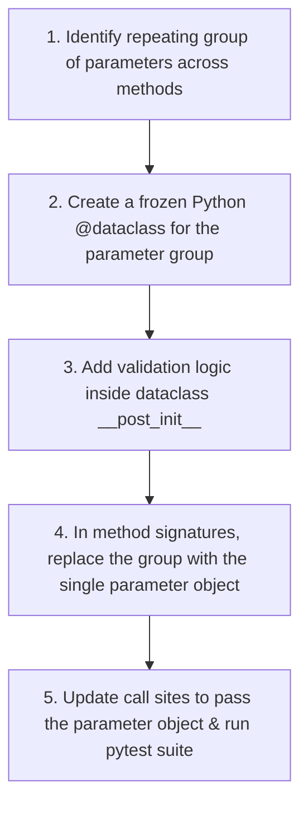

# Introduce Parameter Object 📦

## Source Reference
* **Book:** *Dive Into Refactoring* (Alexander Shvets), Chapter: *Refactoring Techniques / Simplifying Method Calls / Introduce Parameter Object*
* **Design Pattern Bridge:** *Value Object* (Domain-Driven Design)
* **Fixes Code Smells:** [Long Parameter List](../../code-smells/bloaters/long-parameter-list.md), [Data Clumps](../../code-smells/bloaters/data-clumps.md)
* **Target Language:** Modern Python 3 (Python 3.10+) with `pytest`.

---

## 1. Intent and Motivation

Your methods contain a **group of parameters that frequently appear together** across multiple functions (e.g., `start_date, end_date`, `min_val, max_val`, or `street, city, zip_code`).

**Replace these scattered parameters with a single, dedicated Parameter Object (typically an immutable Python `@dataclass`).**

Grouped parameters represent an underlying domain concept waiting to be born. Packaging them into a class turns an anonymous clump of primitive arguments into a self-validating, first-class citizen of your domain.

---

## 2. Step-by-Step Mechanics



1. **Create Class:** Define a `@dataclass(frozen=True)` with the grouped fields.
2. **Move Validation:** Add boundary or formatting validation directly into `__post_init__`.
3. **Update Method Signatures:** Replace the 3+ individual parameters with the single object.
4. **Update Call Sites:** Update callers to instantiate and pass the parameter object.
5. **Test:** Verify with `pytest`.

---

## 3. Python Before & After Demonstration

### A. Smelly / Legacy Code (Date Range Parameters Repeated Across Functions)
```python
# transaction_smelly.py
import datetime


class AccountService:

  def get_transactions_in_range(
      self,
      account_id: str,
      start_date: datetime.date,
      end_date: datetime.date,
  ) -> list[dict]:
    # Smelly: start_date and end_date passed individually; no validation that start <= end
    if start_date > end_date:
      raise ValueError("Start date must precede end date")
    return [{"id": "TX-1", "date": start_date}]

  def get_fee_total_in_range(
      self,
      account_id: str,
      start_date: datetime.date,
      end_date: datetime.date,
  ) -> float:
    if start_date > end_date:
      raise ValueError("Start date must precede end date")
    return 15.0
```

### B. Pytest Baseline Contract
```python
# test_transaction.py
import datetime
import pytest
from transaction_smelly import AccountService


def test_transactions_range():
  service = AccountService()
  d1 = datetime.date(2026, 1, 1)
  d2 = datetime.date(2026, 1, 31)

  assert len(service.get_transactions_in_range("A1", d1, d2)) == 1
  with pytest.raises(ValueError):
    service.get_transactions_in_range("A1", d2, d1)
```

### C. Refactored Clean Code (Introduce Parameter Object - `DateRange`)
```python
# transaction_clean.py
from dataclasses import dataclass
import datetime


@dataclass(frozen=True)
class DateRange:
  """Parameter Object: Encapsulates date range boundaries and validation."""

  start: datetime.date
  end: datetime.date

  def __post_init__(self) -> None:
    if self.start > self.end:
      raise ValueError("Start date must precede end date")

  @property
  def days_span(self) -> int:
    return (self.end - self.start).days

  def includes(self, target: datetime.date) -> bool:
    return self.start <= target <= self.end


class AccountService:
  """Clean service: Methods accept the rich DateRange parameter object."""

  def get_transactions_in_range(
      self, account_id: str, date_range: DateRange
  ) -> list[dict]:
    return [{"id": "TX-1", "date": date_range.start}]

  def get_fee_total_in_range(
      self, account_id: str, date_range: DateRange
  ) -> float:
    return 15.0
```

---

## 4. Complexity, Trade-offs & Anti-patterns

* **Behavior Magnet:** Once a Parameter Object is created, it naturally attracts behavior that previously didn't have a home (like `date_range.includes(date)` or `date_range.days_span`). This transforms an anemic parameter bag into a rich domain model.

---

## 5. Related Techniques & Design Patterns

* **Companion:** [Preserve Whole Object](preserve-whole-object.md).
* **Fixes:** [Long Parameter List](../../code-smells/bloaters/long-parameter-list.md), [Data Clumps](../../code-smells/bloaters/data-clumps.md).
