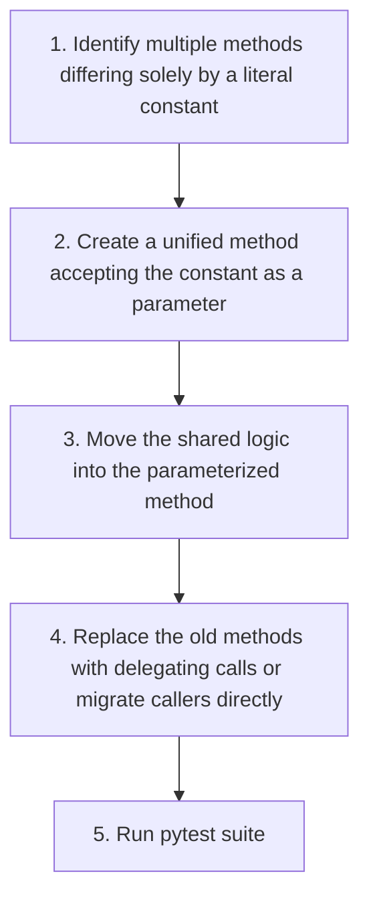

# Parameterize Method 🎛️

## Source Reference
* **Book:** *Dive Into Refactoring* (Alexander Shvets), Chapter: *Refactoring Techniques / Simplifying Method Calls / Parameterize Method*
* **Fixes Code Smells:** [Duplicate Code](../../code-smells/dispensables/duplicate-code.md)
* **Target Language:** Modern Python 3 (Python 3.10+) with `pytest`.

---

## 1. Intent and Motivation

Several methods execute **virtually identical logic, differing only in a hardcoded constant, threshold, or factor** used in their calculation (e.g., `ten_percent_raise()` and `five_percent_raise()`).

**Create a single method that accepts the varying value as a parameter, and replace the duplicated methods with calls to this parameterized method.**

Duplicated methods that differ only by a constant clutter the class's public interface and force maintenance across multiple places whenever the shared calculation logic changes.

---

## 2. Step-by-Step Mechanics



1. **Create Parameterized Method:** Build a single method with an added parameter (e.g., `give_raise(percentage: float)`).
2. **Move Shared Logic:** Implement the calculation once using the parameter.
3. **Deprecate or Migrate:** Update existing callers to pass the explicit parameter.
4. **Test:** Run tests.

---

## 3. Python Before & After Demonstration

### A. Smelly / Legacy Code (Multiple Methods for Minor Variations)
```python
# salary_smelly.py
class Employee:

  def __init__(self, salary: float) -> None:
    self.salary = salary

  # Smelly: Two methods differing only by 0.10 vs 0.05
  def give_ten_percent_raise(self) -> None:
    self.salary += self.salary * 0.10

  def give_five_percent_raise(self) -> None:
    self.salary += self.salary * 0.05
```

### B. Pytest Baseline Contract
```python
# test_salary.py
from salary_smelly import Employee


def test_raises():
  emp1 = Employee(100.0)
  emp1.give_ten_percent_raise()
  assert emp1.salary == 110.0

  emp2 = Employee(100.0)
  emp2.give_five_percent_raise()
  assert emp2.salary == 105.0
```

### C. Refactored Clean Code (Single Parameterized Method)
```python
# salary_clean.py
class Employee:
  """Clean class: Single parameterized method handles arbitrary raise percentages."""

  def __init__(self, salary: float) -> None:
    self.salary = salary

  def apply_raise(self, percentage: float) -> None:
    if percentage < 0:
      raise ValueError("Raise percentage cannot be negative")
    self.salary = round(self.salary * (1.0 + percentage / 100.0), 2)
```

---

## 4. Complexity, Trade-offs & Anti-patterns

* **Opposite Balance:** If passing a parameter forces complex internal `if/elif` branching that alters the whole control flow, do *not* parameterize. Instead, use [Replace Parameter with Explicit Methods](replace-parameter-with-explicit-methods.md).

---

## 5. Related Techniques & Design Patterns

* **Opposite:** [Replace Parameter with Explicit Methods](replace-parameter-with-explicit-methods.md).
* **Fixes:** [Duplicate Code](../../code-smells/dispensables/duplicate-code.md).
