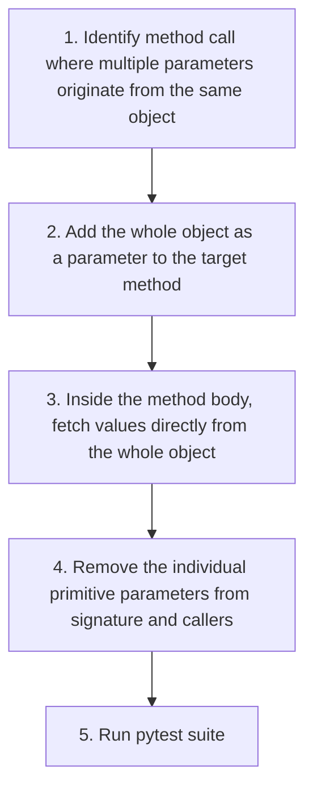

# Preserve Whole Object 📦

## Source Reference
* **Book:** *Dive Into Refactoring* (Alexander Shvets), Chapter: *Refactoring Techniques / Simplifying Method Calls / Preserve Whole Object*
* **Fixes Code Smells:** [Long Parameter List](../../code-smells/bloaters/long-parameter-list.md), [Data Clumps](../../code-smells/bloaters/data-clumps.md)
* **Target Language:** Modern Python 3 (Python 3.10+) with `pytest`.

---

## 1. Intent and Motivation

You get several values from an object (e.g., `low = days_temp_range.get_low(); high = days_temp_range.get_high()`) and **pass them as individual parameters into a method**.

**Pass the whole object instead (`within_plan(days_temp_range)`).**

Extracting 3 or 4 fields from an object just to pass them into a collaborator method creates artificial [Data Clumps](../../code-smells/bloaters/data-clumps.md) and long parameter lists. If the method ever needs another field from the object in the future, you must update the method signature and all callers.

---

## 2. Step-by-Step Mechanics



1. **Add Whole Object:** Add the whole object to the method signature.
2. **Read from Object:** Replace references to the individual parameters with attribute reads on the whole object.
3. **Remove Fragmented Params:** Strip the individual primitive parameters from the signature and update call sites.
4. **Test:** Run tests.

---

## 3. Python Before & After Demonstration

### A. Smelly / Legacy Code (Extracting Fields to Pass Individually)
```python
# temperature_smelly.py
class TempRange:

  def __init__(self, low: int, high: int) -> None:
    self.low = low
    self.high = high


class HeatingPlan:

  def __init__(self, min_temp: int, max_temp: int) -> None:
    self.min_temp = min_temp
    self.max_temp = max_temp

  # Smelly: Caller is forced to extract low and high from TempRange!
  def within_range(self, low: int, high: int) -> bool:
    return low >= self.min_temp and high <= self.max_temp


# Caller code:
def check_heating(plan: HeatingPlan, weather: TempRange) -> bool:
  # Unpacking fields manually:
  low = weather.low
  high = weather.high
  return plan.within_range(low, high)
```

### B. Pytest Baseline Contract
```python
# test_temperature.py
from temperature_smelly import HeatingPlan, TempRange, check_heating


def test_temperature_check():
  plan = HeatingPlan(min_temp=15, max_temp=25)
  weather = TempRange(low=18, high=22)
  assert check_heating(plan, weather) is True
```

### C. Refactored Clean Code (Preserve Whole Object)
```python
# temperature_clean.py
from dataclasses import dataclass


@dataclass(frozen=True)
class TempRange:
  low: int
  high: int


class HeatingPlan:

  def __init__(self, min_temp: int, max_temp: int) -> None:
    self.min_temp = min_temp
    self.max_temp = max_temp

  def includes_range(self, range_to_check: TempRange) -> bool:
    """Clean: Accepts the entire domain object directly."""
    return (
        range_to_check.low >= self.min_temp
        and range_to_check.high <= self.max_temp
    )


def check_heating(plan: HeatingPlan, weather: TempRange) -> bool:
  return plan.includes_range(weather)
```

---

## 4. Complexity, Trade-offs & Anti-patterns

* **Coupling Trade-off:** Passing a whole object introduces a dependency between `HeatingPlan` and `TempRange`. If `HeatingPlan` needs to remain completely decoupled and unaware of `TempRange` (e.g., if it's a generic math range utility), passing primitives is acceptable.

---

## 5. Related Techniques & Design Patterns

* **Companion:** [Introduce Parameter Object](introduce-parameter-object.md).
* **Fixes:** [Long Parameter List](../../code-smells/bloaters/long-parameter-list.md), [Data Clumps](../../code-smells/bloaters/data-clumps.md).
