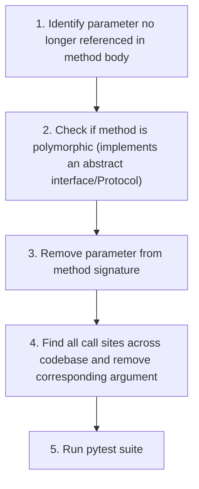

# Remove Parameter ➖

## Source Reference
* **Book:** *Dive Into Refactoring* (Alexander Shvets), Chapter: *Refactoring Techniques / Simplifying Method Calls / Remove Parameter*
* **Fixes Code Smells:** [Dead Code](../../code-smells/dispensables/dead-code.md), [Long Parameter List](../../code-smells/bloaters/long-parameter-list.md)
* **Target Language:** Modern Python 3 (Python 3.10+) with `pytest`.

---

## 1. Intent and Motivation

A parameter is **no longer used by the method body**. **Remove the unused parameter from the method signature and update all call sites.**

Unused parameters are a form of [Dead Code](../../code-smells/dispensables/dead-code.md). They mislead developers into believing that the argument affects the calculation or execution of the method, and force callers to construct and pass dummy values for no reason.

---

## 2. Step-by-Step Mechanics



1. **Verify Usage:** Ensure the parameter is truly never referenced in the method body (or in any subclass overrides).
2. **Check Protocols / Interfaces:** If the method implements a polymorphic interface where other implementations *do* need the parameter, keep the parameter (or prefix with `_unused` in Python).
3. **Remove from Signature:** Delete the parameter.
4. **Update Call Sites:** Remove the argument from all callers.
5. **Test:** Run tests.

---

## 3. Python Before & After Demonstration

### A. Smelly / Legacy Code (Zombified Parameter Left Behind After Refactoring)
```python
# notification_smelly.py
class EmailNotifier:

  # Parameter 'format_type' was made obsolete when HTML became the sole standard:
  def send_email(
      self, recipient: str, subject: str, body: str, format_type: str
  ) -> dict:
    # 'format_type' is never used anywhere in this method!
    return {
        "to": recipient,
        "subject": subject,
        "body": f"<html>{body}</html>",
    }
```

### B. Pytest Baseline Contract
```python
# test_notification.py
from notification_smelly import EmailNotifier


def test_send_email():
  notifier = EmailNotifier()
  # Callers were forced to pass a meaningless "HTML" argument:
  res = notifier.send_email(
      "user@example.com", "Welcome", "Hello!", "HTML"
  )
  assert res["to"] == "user@example.com"
```

### C. Refactored Clean Code (Parameter Removed)
```python
# notification_clean.py
class EmailNotifier:
  """Clean class: Signature reflects strictly required inputs."""

  def send_email(self, recipient: str, subject: str, body: str) -> dict:
    return {
        "to": recipient,
        "subject": subject,
        "body": f"<html>{body}</html>",
    }
```

---

## 4. Complexity, Trade-offs & Anti-patterns

* **Event Handlers & Framework Callbacks:** In GUI frameworks, web servers, or signal handlers (e.g., `def handler(event, *args):`), parameters are mandated by external caller contracts. If you cannot change the framework caller, mark unused parameters with leading underscores (`_event`).

---

## 5. Related Techniques & Design Patterns

* **Opposite:** [Add Parameter](add-parameter.md).
* **Fixes:** [Dead Code](../../code-smells/dispensables/dead-code.md).
