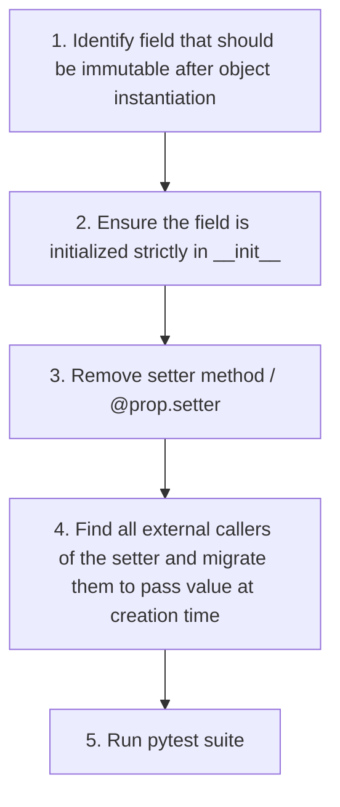

# Remove Setting Method 🔒

## Source Reference
* **Book:** *Dive Into Refactoring* (Alexander Shvets), Chapter: *Refactoring Techniques / Simplifying Method Calls / Remove Setting Method*
* **Design Principle Bridge:** *Immutability*, *Value Objects*
* **Target Language:** Modern Python 3 (Python 3.10+) with `pytest`.

---

## 1. Intent and Motivation

A field in a class is intended to be **set only once upon creation, and must never change throughout the object's lifetime** (e.g., an account ID, transaction hash, or creation timestamp). Yet, the class provides a public setting method (`set_id()`).

**Remove the setting method for that field, and initialize it strictly through the constructor (`__init__`).**

Providing public setters for fields that should be immutable creates temporal bugs, invites unauthorized mutations, and breaks thread-safety. Removing the setter clearly signals to other developers that the field is immutable.

---

## 2. Step-by-Step Mechanics



1. **Check Constructor:** Verify that the field can be passed and initialized in `__init__`.
2. **Remove Setter:** Delete the setter method or `@setter` property decorator.
3. **Make Read-Only:** Provide only a read-only getter (`@property def field(self): return self._field`).
4. **Migrate Callers:** Update any code that called the setter after construction.
5. **Test:** Verify with `pytest`.

---

## 3. Python Before & After Demonstration

### A. Smelly / Legacy Code (Public Setter Allowed Mutating Permanent Identity)
```python
# account_smelly.py
class BankAccount:

  def __init__(self, account_id: str, owner: str) -> None:
    self.account_id = account_id
    self.owner = owner

  # Smelly: Public setter allows reassigning account_id after creation!
  def set_account_id(self, new_id: str) -> None:
    self.account_id = new_id
```

### B. Pytest Baseline Contract
```python
# test_account.py
from account_smelly import BankAccount


def test_account_creation():
  acc = BankAccount("ACC-100", "Alice")
  assert acc.account_id == "ACC-100"
```

### C. Refactored Clean Code (Immutable Read-Only Field)
```python
# account_clean.py
class BankAccount:
  """Clean class: Account ID is strictly immutable after instantiation."""

  def __init__(self, account_id: str, owner: str) -> None:
    if not account_id.strip():
      raise ValueError("Account ID cannot be blank")
    self._account_id = account_id
    self.owner = owner

  @property
  def account_id(self) -> str:
    """Read-only property with zero setter."""
    return self._account_id
```

---

## 4. Complexity, Trade-offs & Anti-patterns

* **Frozen Dataclasses:** In modern Python, you can achieve complete immutability for all fields simultaneously simply by using `@dataclass(frozen=True)`.

---

## 5. Related Techniques & Design Patterns

* **Companion:** [Encapsulate Field](../organizing-data/encapsulate-field.md), [Change Reference to Value](../organizing-data/change-reference-to-value.md).
