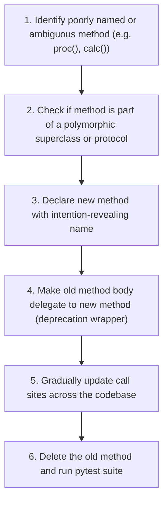

# Rename Method 🏷️

## Source Reference
* **Book:** *Dive Into Refactoring* (Alexander Shvets), Chapter: *Refactoring Techniques / Simplifying Method Calls / Rename Method*
* **Fixes Code Smells:** [Comments](../../code-smells/dispensables/comments.md)
* **Target Language:** Modern Python 3 (Python 3.10+) with `pytest`.

---

## 1. Intent and Motivation

The name of a method **does not clearly explain what the method does or what its intent is**. **Rename the method to a name that clearly conveys its purpose.**

A method's name is the primary documentation of what it does. If you need to read the body of a method or look at a comment to understand its purpose, the method is misnamed. A good name saves thousands of hours of developer comprehension time over the lifespan of a codebase.

---

## 2. Step-by-Step Mechanics



1. **Verify Interfaces:** Check whether the method is defined in a base class, interface, or `Protocol`. If so, update the base definition as well.
2. **Deprecation Shim:** Create the new method with the descriptive name. Turn the old method into a simple one-line forwarder to the new method.
3. **Migrate Call Sites:** Find all references across the project and update them.
4. **Delete Old Method:** Once all callers are migrated, remove the legacy forwarder.
5. **Test:** Verify with `pytest`.

---

## 3. Python Before & After Demonstration

### A. Smelly / Legacy Code (Ambiguous Name with Cryptic Abbreviation)
```python
# person_smelly.py
class Person:

  def __init__(self, first_name: str, last_name: str) -> None:
    self.first_name = first_name
    self.last_name = last_name

  # Ambiguous: Does 'get_t()' return title, telephone, or timestamp?
  def get_t(self) -> str:
    return f"{self.first_name} {self.last_name}"
```

### B. Pytest Baseline Contract
```python
# test_person.py
from person_smelly import Person


def test_person_name():
  p = Person("Clark", "Kent")
  assert p.get_t() == "Clark Kent"
```

### C. Refactored Clean Code (Intention-Revealing Name)
```python
# person_clean.py
class Person:
  """Clean class: Self-documenting method names."""

  def __init__(self, first_name: str, last_name: str) -> None:
    self.first_name = first_name
    self.last_name = last_name

  @property
  def full_name(self) -> str:
    """Intention-revealing property name."""
    return f"{self.first_name} {self.last_name}"

  # Deprecation wrapper for zero-downtime migration:
  def get_t(self) -> str:
    import warnings

    warnings.warn(
        "get_t() is deprecated; use full_name property instead.",
        DeprecationWarning,
        stacklevel=2,
    )
    return self.full_name
```

---

## 4. Complexity, Trade-offs & Anti-patterns

* **Public APIs & Libraries:** If renaming a method in a published library, do not delete the old method immediately. Mark it with `@typing.deprecated` (Python 3.13+) or `warnings.warn(..., DeprecationWarning)` and maintain it across one major version cycle.

---

## 5. Related Techniques & Design Patterns

* **Companion:** [Rename Variable](../composing-methods/extract-variable.md).
