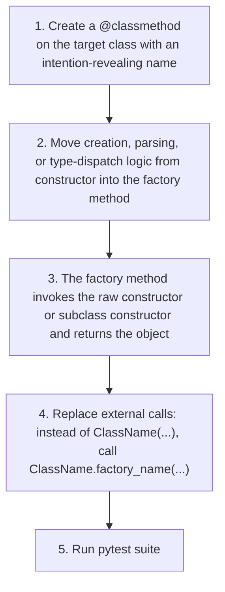

# Replace Constructor with Factory Method 🏭

## Source Reference
* **Book:** *Dive Into Refactoring* (Alexander Shvets), Chapter: *Refactoring Techniques / Simplifying Method Calls / Replace Constructor with Factory Method*
* **Design Pattern Bridge:** [Factory Method Pattern](../../../design-patterns/creational/factory-method.md)
* **Fixes Code Smells:** [Primitive Obsession](../../code-smells/bloaters/primitive-obsession.md), [Switch Statements](../../code-smells/oo-abusers/switch-statements.md)
* **Target Language:** Modern Python 3 (Python 3.10+) with `pytest`.

---

## 1. Intent and Motivation

You have a complex constructor (`__init__`) that **does much more than simply assign fields**, or you need to **return different subclasses or cached instances depending on the parameters**.

**Create a Factory Method (`@classmethod`) with an intention-revealing name, and replace calls to the raw constructor with calls to this factory method.**

Constructors have fundamental limitations:
1. They must return a new instance of the exact class being called (they cannot return an existing cached instance or a polymorphic subclass).
2. They cannot have descriptive names—they are always called `ClassName(...)`. Factory methods have descriptive names like `ComplexNumber.from_polar(r, theta)` and `ComplexNumber.from_cartesian(x, y)`.

---

## 2. Step-by-Step Mechanics



1. **Create Classmethod:** Define a `@classmethod` (e.g., `create_engineer(cls, ...)` or `from_json(cls, ...)`).
2. **Move Logic:** Relocate complex parsing, defaults, or subtype decisions into the classmethod.
3. **Simplify Constructor:** Make the underlying `__init__` dumb: it should only take validated attributes and assign them.
4. **Update Callers:** Migrate callers to use the factory method.
5. **Test:** Verify with `pytest`.

---

## 3. Python Before & After Demonstration

### A. Smelly / Legacy Code (Ambiguous Coordinate Constructor)
```python
# point_smelly.py
import math


class Point:

  # Smelly: What do 'a' and 'b' represent? Cartesian (x, y) or Polar (r, theta)?
  def __init__(
      self, a: float, b: float, is_polar: bool = False
  ) -> None:
    if is_polar:
      self.x = a * math.cos(b)
      self.y = a * math.sin(b)
    else:
      self.x = a
      self.y = b
```

### B. Pytest Baseline Contract
```python
# test_point.py
import math
from point_smelly import Point


def test_points():
  p_cart = Point(3.0, 4.0)
  assert p_cart.x == 3.0 and p_cart.y == 4.0

  p_polar = Point(5.0, 0.0, is_polar=True)
  assert p_polar.x == 5.0 and p_polar.y == 0.0
```

### C. Refactored Clean Code (Descriptive Factory Methods)
```python
# point_clean.py
import math


class Point:
  """Clean class: Direct constructor takes canonical coordinates; Factory Methods provide clear semantic constructors."""

  def __init__(self, x: float, y: float) -> None:
    self.x = x
    self.y = y

  @classmethod
  def from_cartesian(cls, x: float, y: float) -> "Point":
    """Explicit Factory Method for Cartesian space."""
    return cls(x, y)

  @classmethod
  def from_polar(cls, radius: float, angle_radians: float) -> "Point":
    """Explicit Factory Method for Polar space."""
    x = radius * math.cos(angle_radians)
    y = radius * math.sin(angle_radians)
    return cls(round(x, 4), round(y, 4))
```

---

## 4. Complexity, Trade-offs & Anti-patterns

* **Polymorphic Dispatch:** Factory methods can also return different subclasses. For example, `Employee.create("MANAGER", salary)` can return a `Manager` subclass instance while hiding subclass existence from the caller.

---

## 5. Related Techniques & Design Patterns

* **Companion Pattern:** [Factory Method Pattern](../../../design-patterns/creational/factory-method.md), [Abstract Factory](../../../design-patterns/creational/abstract-factory.md).
