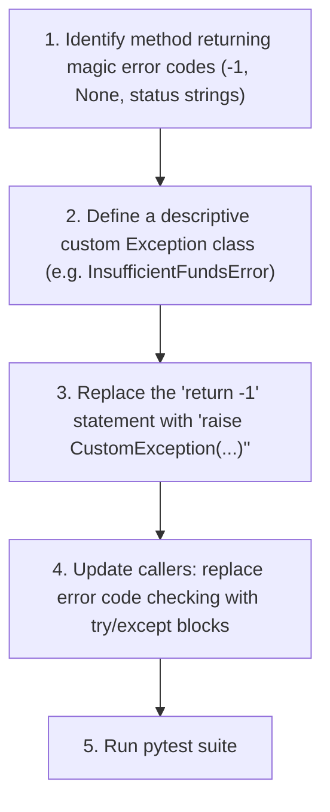

# Replace Error Code with Exception ⚠️

## Source Reference
* **Book:** *Dive Into Refactoring* (Alexander Shvets), Chapter: *Refactoring Techniques / Simplifying Method Calls / Replace Error Code with Exception*
* **Design Principle Bridge:** *Fail Fast Principle*, *EAFP (Easier to Ask for Forgiveness than Permission)*
* **Target Language:** Modern Python 3 (Python 3.10+) with `pytest`.

---

## 1. Intent and Motivation

A method returns a **magic error code (e.g., `-1`, `False`, `None`, or an integer status code like `ERROR_INSUFFICIENT_FUNDS`)** to indicate that an error or invalid condition occurred.

**Raise an explicit Python Exception instead.**

Magic error return codes are a procedural relic of C programming. Callers frequently forget to check return codes (`if res == -1:`), allowing silent failures to propagate through the program until crashing unpredictably elsewhere. Exceptions cannot be ignored silently—they guarantee that unhandled errors stop execution immediately.

---

## 2. Step-by-Step Mechanics



1. **Create Custom Exception:** Inherit from `Exception` or `ValueError` with a clear, domain-specific name.
2. **Raise Exception:** In the method body, replace `return -1` with `raise InsufficientFundsError(...)`.
3. **Update Callers:** Adjust calling code to expect exceptions or handle them using `try...except`.
4. **Test:** Write `pytest.raises()` test contracts.

---

## 3. Python Before & After Demonstration

### A. Smelly / Legacy Code (Magic `-1` Return Code)
```python
# account_smelly.py
class BankAccount:

  def __init__(self, balance: float) -> None:
    self.balance = balance

  # Smelly: Returns -1 for error, 0 for success
  def withdraw(self, amount: float) -> int:
    if amount > self.balance:
      return -1
    self.balance -= amount
    return 0


# Caller can easily forget to check the return code:
def checkout(acc: BankAccount, amount: float) -> None:
  acc.withdraw(amount)  # Silent failure if overdraft occurs!
```

### B. Pytest Baseline Contract
```python
# test_account.py
from account_smelly import BankAccount


def test_withdraw_error_code():
  acc = BankAccount(50.0)
  assert acc.withdraw(100.0) == -1  # Returns error code
```

### C. Refactored Clean Code (Explicit Custom Exception)
```python
# account_clean.py
class InsufficientFundsError(Exception):
  """Domain exception representing withdrawal exceeding account balance."""

  pass


class BankAccount:
  """Clean class: Enforces balance invariants using explicit exceptions."""

  def __init__(self, balance: float) -> None:
    self.balance = balance

  def withdraw(self, amount: float) -> None:
    if amount > self.balance:
      raise InsufficientFundsError(
          f"Cannot withdraw ${amount:.2f}: Current balance is"
          f" ${self.balance:.2f}"
      )
    self.balance -= amount
```

---

## 4. Complexity, Trade-offs & Anti-patterns

* **Expected Business Outcomes:** Do not raise exceptions for everyday, expected conditions (e.g., reaching the end of an iteration or searching for a user that might not exist). Use [Replace Exception with Test](replace-exception-with-test.md) for expected conditions. Exceptions are for truly *exceptional* or invalid states.

---

## 5. Related Techniques & Design Patterns

* **Opposite:** [Replace Exception with Test](replace-exception-with-test.md).
