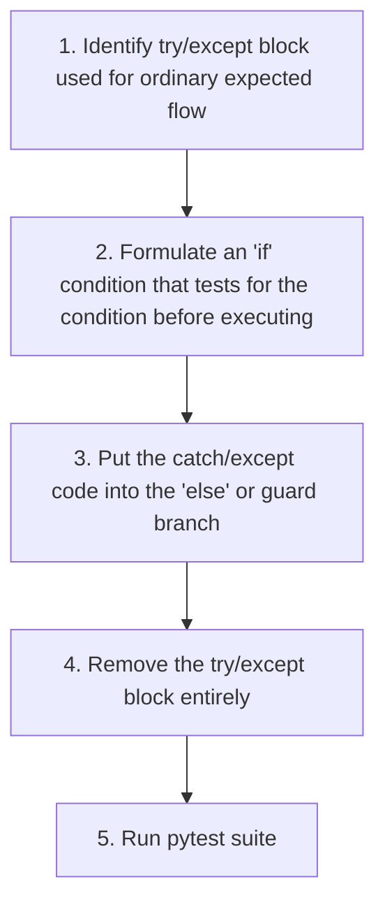

# Replace Exception with Test 🧪

## Source Reference
* **Book:** *Dive Into Refactoring* (Alexander Shvets), Chapter: *Refactoring Techniques / Simplifying Method Calls / Replace Exception with Test*
* **Fixes Code Smells:** Exceptions as Control Flow
* **Target Language:** Modern Python 3 (Python 3.10+) with `pytest`.

---

## 1. Intent and Motivation

You are catching or raising an exception for an **ordinary, everyday condition that could be easily checked in advance using a simple conditional test (`if`)**.

**Replace the exception with a condition test.**

Exceptions should be reserved for exceptional, unexpected occurrences (e.g., hardware failures, network timeouts, or corrupted invariants). Using exceptions for routine control flow (like checking if an array index is in bounds or if a key exists in a dictionary) degrades performance, obscures control flow, and confuses debuggers.

---

## 2. Step-by-Step Mechanics



1. **Identify the Condition:** What condition triggers the exception? (e.g., `index >= len(array)` or `key not in dictionary`).
2. **Pre-Check:** Add a conditional check *before* accessing the resource.
3. **Handle Gracefully:** Return the default value in the condition branch without raising an exception.
4. **Remove Try/Except:** Strip away the exception-handling machinery.
5. **Test:** Run tests.

---

## 3. Python Before & After Demonstration

### A. Smelly / Legacy Code (Using Exception for Everyday Bounds Check)
```python
# array_smelly.py
class ResourcePool:

  def __init__(self, values: list[str]) -> None:
    self.values = values

  # Smelly: Using IndexError as ordinary control flow to return a fallback
  def get_value_at(self, index: int) -> str:
    try:
      return self.values[index]
    except IndexError:
      return "DEFAULT"
```

### B. Pytest Baseline Contract
```python
# test_array.py
from array_smelly import ResourcePool


def test_resource_pool():
  pool = ResourcePool(["A", "B"])
  assert pool.get_value_at(0) == "A"
  assert pool.get_value_at(5) == "DEFAULT"  # Handled via exception
```

### C. Refactored Clean Code (Precondition Check with `if`)
```python
# array_clean.py
class ResourcePool:
  """Clean class: Routine bounds checking handled via simple, fast condition test."""

  def __init__(self, values: list[str]) -> None:
    self.values = values

  def get_value_at(self, index: int) -> str:
    # Explicit bounds check replaces costly exception mechanism:
    if 0 <= index < len(self.values):
      return self.values[index]
    return "DEFAULT"
```

---

## 4. Complexity, Trade-offs & Anti-patterns

* **Python's EAFP vs LBYL:**
  - In Python, EAFP (*Easier to Ask for Forgiveness than Permission*) is standard for I/O and dictionary lookups when the key is *almost always* present (`dict.get()` handles this natively without exceptions).
  - However, when the condition happens routinely in expected business logic (like checking user input ranges), LBYL (*Look Before You Leap*) with clear guard clauses is cleaner and avoids filling debug logs with handled tracebacks.

---

## 5. Related Techniques & Design Patterns

* **Opposite:** [Replace Error Code with Exception](replace-error-code-with-exception.md).
* **Companion:** [Replace Nested Conditional with Guard Clauses](../simplifying-conditionals/replace-nested-conditional-with-guard-clauses.md).
