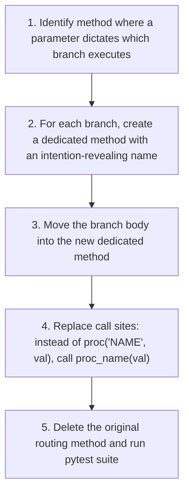

# Replace Parameter with Explicit Methods 🎯

## Source Reference
* **Book:** *Dive Into Refactoring* (Alexander Shvets), Chapter: *Refactoring Techniques / Simplifying Method Calls / Replace Parameter with Explicit Methods*
* **Fixes Code Smells:** [Long Parameter List](../../code-smells/bloaters/long-parameter-list.md), [Switch Statements](../../code-smells/oo-abusers/switch-statements.md)
* **Target Language:** Modern Python 3 (Python 3.10+) with `pytest`.

---

## 1. Intent and Motivation

A method contains an internal conditional (`if/else` or `match/case`) that **executes completely different code paths depending on the value of a passed parameter (often a boolean flag or type code)**: `set_value("height", 100)` or `save(is_async=True)`.

**Create separate, explicit methods for each value of the parameter (`set_height(100)` and `set_width(100)`), and delete the conditional routing method.**

Passing boolean flags or type codes forces callers to pass literal strings or flags (`do_task(True, False, 1)`) that mean nothing to someone reading the call site. Explicit method names are clear, type-safe, and self-documenting.

---

## 2. Step-by-Step Mechanics



1. **Create Explicit Methods:** For each value of the parameter, define an explicit method whose name explains the specific action.
2. **Move Logic:** Copy the code from each conditional branch into its corresponding explicit method.
3. **Update Callers:** Replace `set_value("HEIGHT", h)` with `set_height(h)`.
4. **Delete Routing Method:** Remove the original branching method.
5. **Test:** Verify with `pytest`.

---

## 3. Python Before & After Demonstration

### A. Smelly / Legacy Code (Type-Code Router Method)
```python
# engineer_smelly.py
class Engineer:

  def __init__(self) -> None:
    self.height = 0
    self.width = 0

  # Smelly: 'name' string controls which field is mutated
  def set_dimension(self, name: str, value: int) -> None:
    if name == "HEIGHT":
      self.height = value
    elif name == "WIDTH":
      self.width = value
    else:
      raise ValueError(f"Unknown dimension: {name}")
```

### B. Pytest Baseline Contract
```python
# test_engineer.py
from engineer_smelly import Engineer


def test_set_dimensions():
  eng = Engineer()
  eng.set_dimension("HEIGHT", 180)
  eng.set_dimension("WIDTH", 75)
  assert eng.height == 180
  assert eng.width == 75
```

### C. Refactored Clean Code (Explicit Methods)
```python
# engineer_clean.py
class Engineer:
  """Clean class: Direct, explicit, type-safe property setters."""

  def __init__(self) -> None:
    self.height = 0
    self.width = 0

  def set_height(self, value: int) -> None:
    self.height = value

  def set_width(self, value: int) -> None:
    self.width = value
```

---

## 4. Complexity, Trade-offs & Anti-patterns

* **When NOT to Use:** If the parameter is dynamic data calculated at runtime and cannot be known at compile/authoring time, an explicit method cannot be called statically. In that case, keep the parameterized method or use a dispatch table dictionary.

---

## 5. Related Techniques & Design Patterns

* **Opposite:** [Parameterize Method](parameterize-method.md).
* **Fixes:** [Switch Statements](../../code-smells/oo-abusers/switch-statements.md).
