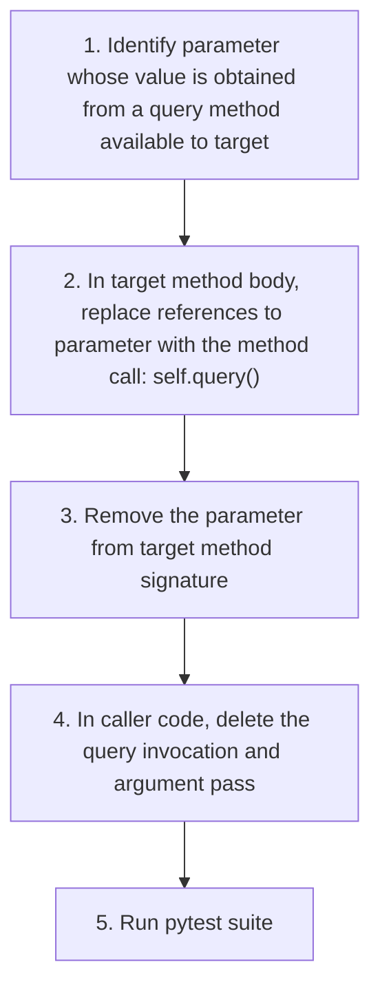

# Replace Parameter with Method Call 📞

## Source Reference
* **Book:** *Dive Into Refactoring* (Alexander Shvets), Chapter: *Refactoring Techniques / Simplifying Method Calls / Replace Parameter with Method Call*
* **Fixes Code Smells:** [Long Parameter List](../../code-smells/bloaters/long-parameter-list.md)
* **Target Language:** Modern Python 3 (Python 3.10+) with `pytest`.

---

## 1. Intent and Motivation

A calling method invokes a query to fetch a value, and then **passes that result as a parameter into another method on the same object (or on an accessible collaborator)**, even though the called method could easily invoke that query itself.

**Remove the parameter from the called method and let the method invoke the query directly.**

Passing data that the target method can readily fetch itself inflates parameter lists and forces callers to know about internal calculation dependencies.

---

## 2. Step-by-Step Mechanics



1. **Verify Availability:** Ensure the called method can access the query method without creating an unwanted circular dependency.
2. **Replace Parameter:** In the called method body, replace the parameter with `self.get_query_val()`.
3. **Remove from Signature:** Delete the parameter.
4. **Clean Callers:** Update callers to stop fetching and passing the value.
5. **Test:** Run tests.

---

## 3. Python Before & After Demonstration

### A. Smelly / Legacy Code (Caller Forced to Fetch and Pass Discount Factor)
```python
# order_smelly.py
class Order:

  def __init__(self, quantity: int, item_price: float) -> None:
    self.quantity = quantity
    self.item_price = item_price

  def calculate_discount_level(self) -> int:
    return 2 if self.quantity > 100 else 1

  # Smelly: Caller must query calculate_discount_level() and pass it here!
  def calculate_final_price(self, discount_level: int) -> float:
    base = self.quantity * self.item_price
    discount = 0.10 if discount_level == 2 else 0.05
    return base * (1.0 - discount)


# Caller code:
def checkout(order: Order) -> float:
  # Unnecessary query on caller side:
  level = order.calculate_discount_level()
  return order.calculate_final_price(level)
```

### B. Pytest Baseline Contract
```python
# test_order.py
from order_smelly import Order, checkout


def test_order_checkout():
  order = Order(quantity=150, item_price=10.0)
  assert checkout(order) == 1350.0  # 1500 * 0.90
```

### C. Refactored Clean Code (Target Method Fetches Its Own Query)
```python
# order_clean.py
class Order:
  """Clean class: encapsulated calculations with simplified parameter list."""

  def __init__(self, quantity: int, item_price: float) -> None:
    self.quantity = quantity
    self.item_price = item_price

  @property
  def base_price(self) -> float:
    return self.quantity * self.item_price

  @property
  def discount_level(self) -> int:
    return 2 if self.quantity > 100 else 1

  def calculate_final_price(self) -> float:
    """Clean method: fetches discount level internally without forcing caller to pass it."""
    discount = 0.10 if self.discount_level == 2 else 0.05
    return self.base_price * (1.0 - discount)


def checkout(order: Order) -> float:
  return order.calculate_final_price()
```

---

## 4. Complexity, Trade-offs & Anti-patterns

* **When NOT to Use:** If fetching the value inside the method would introduce an undesirable dependency on an external system, or if you want to keep the target method a pure function for easy unit testing, passing the parameter is preferred.

---

## 5. Related Techniques & Design Patterns

* **Opposite:** [Add Parameter](add-parameter.md) (when deliberately decoupling a method from a receiver).
