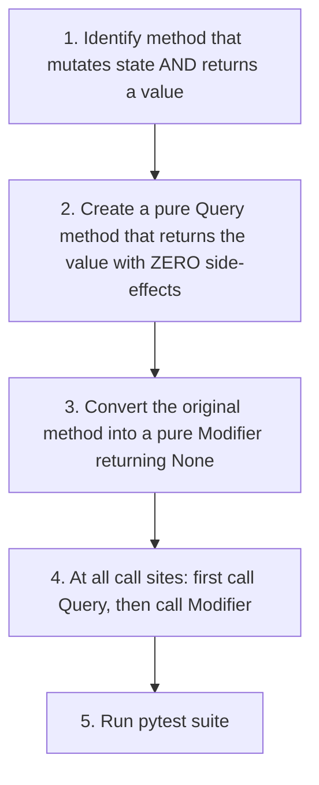

# Separate Query from Modifier (CQS) ⚖️

## Source Reference
* **Book:** *Dive Into Refactoring* (Alexander Shvets), Chapter: *Refactoring Techniques / Simplifying Method Calls / Separate Query from Modifier*
* **Design Principle Bridge:** *Command-Query Separation (CQS)* (Bertrand Meyer)
* **Target Language:** Modern Python 3 (Python 3.10+) with `pytest`.

---

## 1. Intent and Motivation

You have a method that **both returns a value and alters the internal state of the object (or creates observable side-effects)**.

**Split the method into two separate methods: a Query method that returns the value with zero side-effects, and a Modifier (Command) method that performs the state change and returns nothing (`None`).**

> *"Asking a question should not change the answer."* — Bertrand Meyer

When a method mutates state while returning a value, callers cannot safely inspect the object (e.g., in a debug logger, in an assert statement, or multiple times in an algorithm) without triggering unwanted state mutations or side effects.

---

## 2. Step-by-Step Mechanics



1. **Create Query:** Create a method that returns the same value as the original method, but remove all mutation/side-effect code from it.
2. **Transform Modifier:** Modify the original method so that it only executes the state changes and returns `None`.
3. **Update Call Sites:** Where callers used the original method, change them to invoke the query and the command explicitly.
4. **Test:** Verify with `pytest`.

---

## 3. Python Before & After Demonstration

### A. Smelly / Legacy Code (Method Queries Security AND Sends Alert Email)
```python
# security_smelly.py
class SecuritySystem:

  def __init__(self) -> None:
    self.alerts_sent = 0

  # Smelly: Returns a string BUT ALSO increments alerts and triggers side effects!
  def check_security(self, people: list[str]) -> str:
    for person in people:
      if person in ("Don", "John"):
        # Side effect inside a query method!
        self._send_police_alert(person)
        return person
    return ""

  def _send_police_alert(self, person: str) -> None:
    self.alerts_sent += 1
```

### B. Pytest Baseline Contract
```python
# test_security.py
from security_smelly import SecuritySystem


def test_security_check():
  sec = SecuritySystem()
  # Calling the check triggers the side effect:
  assert sec.check_security(["Alice", "Don"]) == "Don"
  assert sec.alerts_sent == 1
```

### C. Refactored Clean Code (Command-Query Separation)
```python
# security_clean.py
class SecuritySystem:
  """Clean class: Strict Command-Query Separation (CQS)."""

  def __init__(self) -> None:
    self.alerts_sent = 0

  # 1. Pure Query: Safe to call repeatedly in assertions/logs with zero side effects:
  def find_security_risk(self, people: list[str]) -> str | None:
    suspects = {"Don", "John"}
    for person in people:
      if person in suspects:
        return person
    return None

  # 2. Pure Command (Modifier): Performs the action:
  def alert_authorities(self, person: str) -> None:
    self.alerts_sent += 1


# Caller controls decision and side-effect explicitly:
def verify_access(system: SecuritySystem, people: list[str]) -> None:
  risk = system.find_security_risk(people)
  if risk:
    system.alert_authorities(risk)
```

---

## 4. Complexity, Trade-offs & Anti-patterns

* **Concurrent Multi-Threading:** In multi-threaded environments, atomic operations like `dict.pop(key)` or `queue.get()` deliberately combine querying and removing to avoid race conditions between checking and removing. For thread-safe data structures, combined operations are acceptable.

---

## 5. Related Techniques & Design Patterns

* **Companion:** [Replace Temp with Query](../composing-methods/replace-temp-with-query.md).
