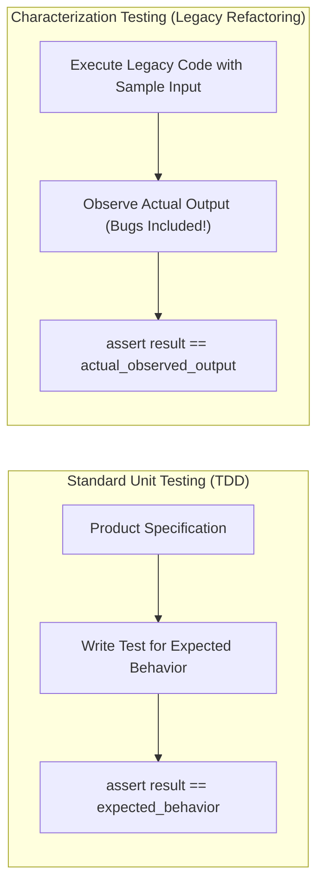

# Characterization Tests 🧪

## Source Reference
* **Author:** Michael Feathers (*Working Effectively with Legacy Code*)
* **Core Philosophy:** A characterization test is a test that characterizes the actual behavior of a piece of code. You are not trying to catch bugs; you are trying to capture what the system *currently does*.

---

## 1. The Purpose of Characterization Testing

When you inherit an old, gnarly Python module with zero documentation, you cannot write standard unit tests based on specifications because **there is no specification**. 

If you try to write tests based on what you *assume* the code should do, you will inevitably break subtle behavior that downstream clients depend on.



> [!IMPORTANT]
> **The Golden Rule:** When writing characterization tests, the current behavior is always treated as correct. Even if you discover a bug (e.g., negative tax allowed), you document it in the test and do not "fix" it yet. First lock down behavior; refactor; then fix the bug under a green test suite.

---

## 2. The 4-Step Characterization Algorithm

1. **Invoke the legacy function** in a test with representative inputs.
2. **Write a deliberately failing assertion** (e.g., `assert result == None` or `assert False`).
3. **Run `pytest`** and let the failure message reveal the real, actual output produced by the code.
4. **Copy the actual output** into the test assertion: `assert result == <actual_value>`.

Now you have a regression lock! Any subsequent refactoring that accidentally alters this calculation will immediately trigger a red failure.

---

## 3. Concrete Python Demonstration: Approval / Golden Master Testing

When refactoring functions that return large complex payloads (nested dictionaries, generated invoices, or HTML/JSON reports), comparing individual fields is tedious. Instead, use the **Golden Master** approach.

### The Legacy Code (Complex Pricing Engine)
```python
# legacy_invoicing.py
def generate_invoice_data(
    customer_id: str, tier: str, usage_kwh: float
) -> dict:
  # Highly convoluted legacy logic
  base_rate = 0.15 if tier == "COMMERCIAL" else 0.12
  energy_charge = usage_kwh * base_rate

  environmental_fee = 14.50 if usage_kwh > 500 else 5.00
  grid_tax = (energy_charge + environmental_fee) * 0.045

  total = energy_charge + environmental_fee + grid_tax
  if customer_id.startswith("VIP-"):
    total *= 0.95  # 5% loyalty discount

  return {
      "customer_id": customer_id,
      "tier": tier,
      "usage_kwh": usage_kwh,
      "energy_charge": round(energy_charge, 2),
      "environmental_fee": environmental_fee,
      "grid_tax": round(grid_tax, 2),
      "total_due": round(total, 2),
  }
```

### The Golden Master Characterization Suite (`pytest`)
We generate a matrix of inputs and lock down the output snapshot:

```python
# test_legacy_invoicing_characterization.py
from legacy_invoicing import generate_invoice_data
import pytest

GOLDEN_MASTER_CASES = [
    # (customer_id, tier, usage_kwh, expected_snapshot)
    (
        "CUST-101",
        "RESIDENTIAL",
        350.0,
        {
            "customer_id": "CUST-101",
            "tier": "RESIDENTIAL",
            "usage_kwh": 350.0,
            "energy_charge": 42.0,
            "environmental_fee": 5.0,
            "grid_tax": 2.12,
            "total_due": 49.12,
        },
    ),
    (
        "CUST-202",
        "COMMERCIAL",
        1200.0,
        {
            "customer_id": "CUST-202",
            "tier": "COMMERCIAL",
            "usage_kwh": 1200.0,
            "energy_charge": 180.0,
            "environmental_fee": 14.5,
            "grid_tax": 8.75,
            "total_due": 203.25,
        },
    ),
    (
        "VIP-888",
        "COMMERCIAL",
        1000.0,
        {
            "customer_id": "VIP-888",
            "tier": "COMMERCIAL",
            "usage_kwh": 1000.0,
            "energy_charge": 150.0,
            "environmental_fee": 14.5,
            "grid_tax": 7.4,
            "total_due": 163.31,
        },
    ),
]


@pytest.mark.parametrize(
    "cust_id, tier, usage, expected_dict", GOLDEN_MASTER_CASES
)
def test_invoice_golden_master(cust_id, tier, usage, expected_dict):
  actual = generate_invoice_data(cust_id, tier, usage)
  assert actual == expected_dict
```

---

## 4. Key Takeaways

1. **Characterization tests establish baseline reality, not ideal behavior.**
2. **Preserve discovered quirks:** If legacy code treats `None` as `0.0`, your test must assert that `None` returns `0.0`.
3. Once characterization tests pass, you are free to refactor functions, split classes, and clean variable names without fear of regressing production behavior.
