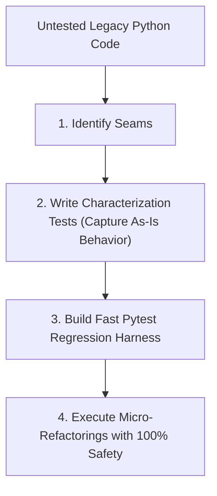

# Testing Strategy for Refactoring 🧪

> *"Refactoring without automated tests is not refactoring—it is merely changing code with hope."*

Welcome to the **Testing Strategy Hub**. In legacy systems, fear of breaking existing features is the number one reason teams avoid refactoring. This section provides an unbreakable engineering playbook for erecting automated test safety nets around untested, tightly coupled Python code.

---

## 🧭 Testing Modules & Guides

### 1. [Characterization Tests](characterization-tests.md)
* How to write tests when there are zero requirements and no documentation.
* The cardinal rule: *pinning down what the software actually does right now, including its quirks and edge-case bugs*.
* **Approval Testing & Golden Master Testing** in Python for complex outputs (JSON, HTML, CSV).

### 2. [Pytest for Refactoring](pytest-for-refactoring.md)
* Fast, expressive testing patterns specifically suited for refactoring.
* Parametrized tests (`@pytest.mark.parametrize`) to test wide combinatorial matrices in 5 lines of code.
* Safe isolation using `pytest` fixtures, `tmp_path`, and `monkeypatch`.

### 3. [Regression Testing & Test Pyramid](regression-testing.md)
* The Refactoring Test Pyramid: why 500 fast unit tests (1 second) beat 10 slow end-to-end Selenium tests (10 minutes).
* Measuring safety: Test Coverage vs. Test Quality.
* **Mutation Testing** in Python (`mutmut`): testing the tests to ensure they actually catch regressions.

### 4. [Refactoring Without Existing Tests](refactoring-without-tests.md)
* The Catch-22: *to write tests, you need to break dependencies; to break dependencies, you need tests*.
* Michael Feathers' **Seam Model** adapted for Python: Object Seams, Module Monkeypatch Seams, and Subclass and Override seams.
* Minimum-invasive surgical interventions to make monolithic code testable.
