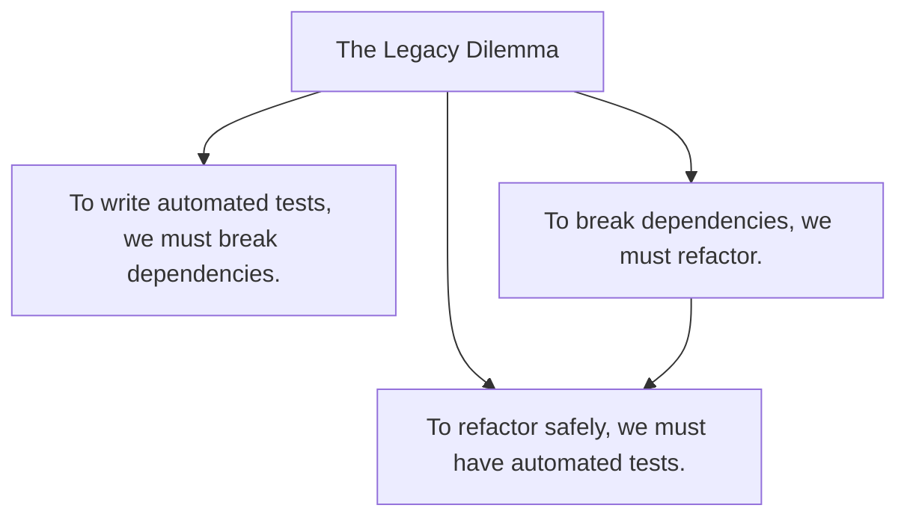
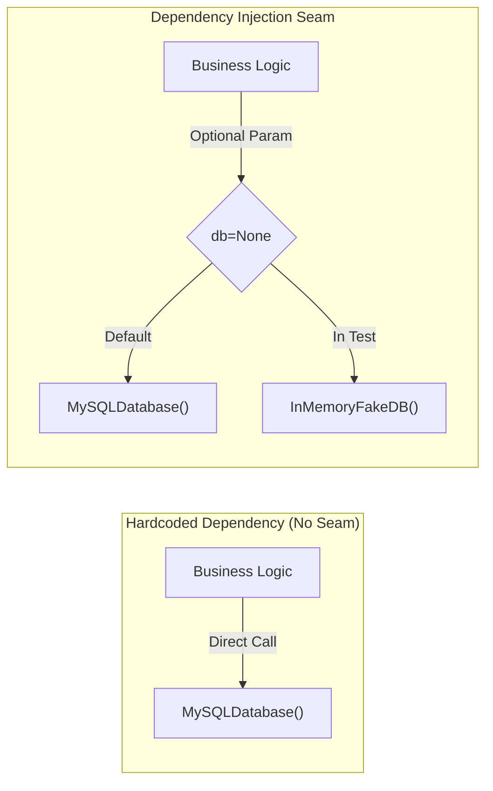

# Refactoring Without Existing Tests 🚧

## Source Reference
* **Author:** Michael Feathers (*Working Effectively with Legacy Code*)
* **Core Philosophy:** Breaking the Catch-22 of legacy software using minimally invasive seams.

---

## 1. The Legacy Code Catch-22

Every software engineer eventually encounters the fundamental paradox of legacy code:



If a class directly creates a MySQL connection inside its `__init__`, you cannot instantiate it in a unit test without connecting to a live database. But changing `__init__` is a refactoring—which you are afraid to do without tests!

---

## 2. Breaking the Paradox: The "Seam" Concept

Michael Feathers defines a **Seam** as:
> *"A place where you can alter behavior in your program without editing in that place."*

In Python, because of dynamic binding, first-class functions, and optional typing, creating seams is significantly easier than in statically typed languages like Java or C++.



---

## 3. The 3 Minimally Invasive Seams in Python

### Seam 1: Default Parameter Injection (The Least Invasive Seam)
Without altering how any existing caller in production invokes the class, add an optional parameter with a default fallback:

```python
# Before (Untestable: Instantiates live third-party client)
class OrderNotifier:

  def __init__(self):
    self.mailer = SendGridMailClient(api_key=os.environ["SENDGRID_KEY"])


# After (Minimally Invasive Seam: 100% backwards compatible!)
class OrderNotifier:

  def __init__(self, mailer=None):
    # If not provided by a test, fallback to production client
    self.mailer = mailer or SendGridMailClient(
        api_key=os.environ.get("SENDGRID_KEY", "")
    )
```

Now, in your test, you can pass a simple fake or mock object:
```python
def test_order_notifier():
  fake_mailer = FakeMailClient()
  notifier = OrderNotifier(mailer=fake_mailer)
  notifier.notify_customer("Order #123 confirmed")
  assert fake_mailer.sent_messages == ["Order #123 confirmed"]
```

---

### Seam 2: Subclass and Override Method
If a legacy class calls an expensive global function or third-party service directly inside a private method, subclass the class in your test module and override *only* that method:

```python
# legacy_service.py
class InvoiceService:

  def process_invoice(self, order_id: str) -> None:
    # ... business calculations ...
    self._send_to_stripe(order_id)  # Hardcoded external call

  def _send_to_stripe(self, order_id: str) -> None:
    StripeAPI.charge(order_id)  # Production side-effect!
```

In your test file:
```python
# test_invoice_service.py
from legacy_service import InvoiceService


class TestableInvoiceService(InvoiceService):
  """Subclass seam: Overrides only the destructive external side effect."""

  def __init__(self):
    super().__init__()
    self.charged_orders = []

  def _send_to_stripe(self, order_id: str) -> None:
    self.charged_orders.append(order_id)


def test_process_invoice():
  service = TestableInvoiceService()
  service.process_invoice("ORD-999")
  assert service.charged_orders == ["ORD-999"]
```

---

### Seam 3: Module-Level Monkeypatching
Because Python modules are dynamic dictionaries in `sys.modules`, you can use `pytest`'s `monkeypatch` to intercept calls at import borders without touching production source code:

```python
def test_with_monkeypatch(monkeypatch):
  # Intercept the external function at the boundary
  monkeypatch.setattr(
      "legacy_service.StripeAPI.charge", lambda order_id: "SUCCESS"
  )

  service = InvoiceService()
  service.process_invoice("ORD-100")
```

---

## 4. The Golden Rule of Legacy Seams

> [!CAUTION]
> **Minimal Surgery Only:** When introducing a seam into untested code, make the **smallest possible edit** required to get the first test to pass. Do not clean up variable names, do not extract classes, and do not reorganize imports yet. 
> 
> Once the first test is green, **then and only then** do you have permission to begin real refactoring.
